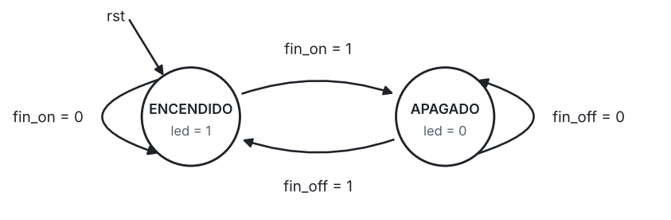
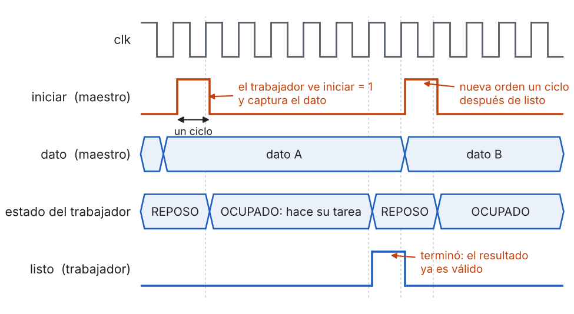
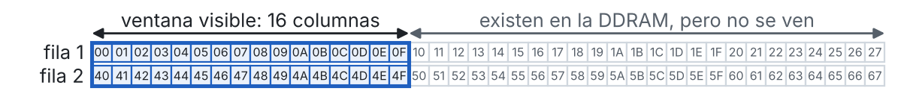
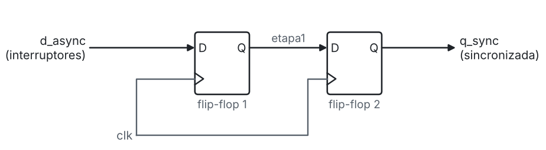
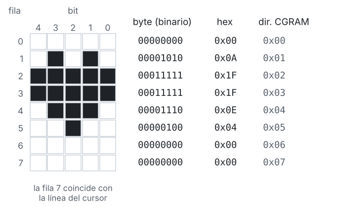

# Laboratorio 5 – Fundamentos básicos

Este documento reúne las técnicas de Verilog que se usan en el laboratorio, cada una con un código sencillo y explicado. Cada sección tiene la misma estructura:

1. **La idea**, en pocas palabras.
2. **Un código corto**, tomado de la carpeta [`ejemplos`](ejemplos), donde está completo y con su testbench.
3. **La explicación** de las líneas importantes.
4. **Dónde se usa** en el laboratorio.

| Parte | Secciones más útiles |
|---|---|
| Parte 1: entender el código base | 1 a 5 y 9 |
| Parte 2: mostrar valores que cambian | 2, 4, 6, 7, 8 y 9 |

---

## Contenido

1. [La LCD vista desde la FPGA](#1-la-lcd-vista-desde-la-fpga)
2. [Medir tiempo con un contador](#2-medir-tiempo-con-un-contador)
3. [Máquinas de estados en Verilog](#3-máquinas-de-estados-en-verilog)
4. [Dos máquinas que trabajan juntas: *handshake*](#4-dos-máquinas-que-trabajan-juntas-handshake)
5. [Textos en Verilog](#5-textos-en-verilog)
6. [Ubicar el cursor](#6-ubicar-el-cursor)
7. [Del número a los caracteres](#7-del-número-a-los-caracteres)
8. [Leer los interruptores](#8-leer-los-interruptores)
9. [Simular con el modelo de la LCD](#9-simular-con-el-modelo-de-la-lcd)
10. [Problemas frecuentes en la tarjeta](#10-problemas-frecuentes-en-la-tarjeta)
11. [Para ir más allá: caracteres personalizados](#11-para-ir-más-allá-caracteres-personalizados)

---

## 1. La LCD vista desde la FPGA

**La idea.** Para la FPGA, la LCD es un dispositivo al que se le envían bytes, uno a la vez. Cada byte es una **instrucción** (`RS = 0`), por ejemplo "borrar" o "ubicar el cursor", o el **código de un carácter** (`RS = 1`). La LCD nunca se lee: `R/W` vale siempre 0.

Para enviar un byte la FPGA hace cuatro pasos:

1. Pone `RS` y el byte en el bus `D7–D0`.
2. Sube `E`.
3. Baja `E`: **en ese flanco de bajada la LCD captura el byte**.
4. Espera a que la LCD termine de ejecutarlo (39 µs a 43 µs, o 1,53 ms para Clear Display) antes de enviar el siguiente.

<p align="center">
 
</p>
<p align="center">
 Figura 1: Ciclo de escritura de un byte
</p>

Por ejemplo, para escribir `A` al comienzo de la fila 2 se envían dos bytes:

| Byte | RS | Significado |
|---|---|---|
| 0xC0 | 0 | Instrucción: ubicar el cursor en la fila 2, columna 0 (sección 6) |
| 0x41 | 1 | Carácter `A` |

Antes de escribir caracteres, la LCD debe **inicializarse** con la secuencia de la hoja de datos (Parte 1, sección 2.6).

**Dónde se usa.** `lcd_escritura.v` hace los cuatro pasos para un byte; `lcd_ctrl.v` decide qué bytes se envían y en qué orden.

---

## 2. Medir tiempo con un contador

**La idea.** En la FPGA el tiempo se mide contando ciclos de reloj. Con un reloj de 50 MHz cada ciclo dura 20 ns, así que un intervalo *t* equivale a:

$$N = t \cdot f_{clk}$$

| Intervalo | Ciclos a 50 MHz |
|---|---|
| 1 µs | 50 |
| 1 ms | 50 000 |
| 100 ms | 5 000 000 |
| 1 s | 50 000 000 |

Un contador que va de 0 a *N* – 1 necesita los bits para representar *N* – 1. En Verilog, `$clog2(N)` calcula ese número de bits.

**El código** ([`ejemplos/base_tiempo.v`](ejemplos/base_tiempo.v)): genera un pulso de un ciclo (`tick`) cada `PERIODO_MS` milisegundos.

```verilog
localparam N = (CLK_FREQ / 1000) * PERIODO_MS;   // ciclos por periodo
localparam W = $clog2(N);                        // bits del contador
localparam [W-1:0] MAX = N[W-1:0] - 1'b1;        // último valor de la cuenta

reg [W-1:0] cuenta;

always @(posedge clk)
    if (rst) begin
        cuenta <= 0;
        tick   <= 1'b0;
    end else if (cuenta == MAX) begin            // llegó al final:
        cuenta <= 0;                             //   vuelve a empezar
        tick   <= 1'b1;                          //   y da un pulso
    end else begin
        cuenta <= cuenta + 1'b1;
        tick   <= 1'b0;
    end
```

**La explicación.**

- Los `localparam` se calculan al sintetizar: no generan hardware. Si cambia `CLK_FREQ`, todo se recalcula solo.
- `MAX` tiene el mismo ancho que el contador, así la comparación `cuenta == MAX` es entre dos números de *W* bits.
- `tick` dura un solo ciclo. Se usa como **habilitación**, nunca como reloj:

```verilog
// Contador de segundos: cambia una vez por segundo, pero sigue usando clk
always @(posedge clk)
    if (rst)          segundos <= 0;
    else if (tick_1s) segundos <= segundos + 1'b1;
```

**Dónde se usa.** `lcd_escritura.v` mide así los tiempos de cada byte y `lcd_ctrl.v` la espera de encendido. En la Parte 2 sirve para el contador del valor B y para el periodo de refresco.

---

## 3. Máquinas de estados en Verilog

**La idea.** Una máquina de estados está en un solo estado a la vez y pasa de uno a otro cuando se cumple una condición. En Verilog se describe en **tres bloques**, cada uno con una sola función.

**El código** ([`ejemplos/parpadeo.v`](ejemplos/parpadeo.v)): un LED que se enciende `T_ON_MS` milisegundos y se apaga `T_OFF_MS` milisegundos.

```verilog
localparam ENCENDIDO = 1'b0,
           APAGADO   = 1'b1;

reg         estado, siguiente;
reg [W-1:0] cuenta;                     // ciclos que lleva en el estado actual

wire fin_on  = (cuenta == MAX_ON);
wire fin_off = (cuenta == MAX_OFF);

// 1. Registro de estado: guarda el estado actual
always @(posedge clk)
    if (rst) estado <= ENCENDIDO;
    else     estado <= siguiente;

// 2. Lógica de siguiente estado: decide a dónde ir
always @(*) begin
    siguiente = estado;                 // por defecto, quedarse
    case (estado)
        ENCENDIDO: if (fin_on)  siguiente = APAGADO;
        APAGADO:   if (fin_off) siguiente = ENCENDIDO;
        default:                siguiente = ENCENDIDO;
    endcase
end

// Contador de tiempo: vuelve a cero cada vez que cambia el estado
always @(posedge clk)
    if (rst || estado != siguiente) cuenta <= 0;
    else                            cuenta <= cuenta + 1'b1;

// 3. Salida registrada
always @(posedge clk)
    if (rst) led <= 1'b0;
    else     led <= (siguiente == ENCENDIDO);
```

**La explicación.**

| Bloque | Qué contiene | Cómo se escribe |
|---|---|---|
| 1. Registro de estado | El estado actual y su valor después del reset | `always @(posedge clk)`, asignación `<=` |
| 2. Siguiente estado | Las transiciones y sus condiciones | `always @(*)`, asignación `=` |
| 3. Salida | El valor de cada salida según el estado | Aquí, registrada con `<=` |

- La línea `siguiente = estado;` evita olvidar un caso: si no se cumple ninguna condición, la máquina se queda donde está.
- **Estados con duración.** Un solo contador sirve para todos los estados: se pone en 0 cada vez que la máquina cambia de estado (`estado != siguiente`), así en cada estado la cuenta empieza desde 0.
- **Salida registrada.** `led <= (siguiente == ENCENDIDO)` hace que la salida salga de un flip-flop, sin pulsos espurios. Usar `siguiente` en lugar de `estado` evita que la salida cambie un ciclo tarde.

**Del código al diagrama.** Para dibujar el diagrama de estados de un código:

1. Los **estados** son las constantes `localparam` que toma el registro de estado.
2. Las **flechas** están en el bloque de siguiente estado: cada `if` es una flecha y su condición es la etiqueta.
3. La línea `siguiente = estado;` es la flecha que vuelve al mismo estado cuando la condición no se cumple.
4. El **estado inicial** es el que se asigna en el reset.

<p align="center">
 
</p>
<p align="center">
 Figura 2: Diagrama de estados de parpadeo.v
</p>

| Estado actual | Condición | Siguiente estado | Salida |
|---|---|---|---|
| ENCENDIDO | `fin_on = 0` | ENCENDIDO | `led = 1` |
| ENCENDIDO | `fin_on = 1` | APAGADO | `led = 1` |
| APAGADO | `fin_off = 0` | APAGADO | `led = 0` |
| APAGADO | `fin_off = 1` | ENCENDIDO | `led = 0` |

**Errores frecuentes.**

- Una señal que no recibe valor en todos los casos de un `always @(*)` crea un *latch* (Quartus avisa: *inferring latch(es)*). Se evita dando un valor por defecto al comienzo del bloque.
- Asignar la misma señal en dos bloques `always` es un error (*multiple constant drivers*).
- Usar una señal como reloj (`always @(posedge tick)`) crea problemas de tiempo en la tarjeta. Todo el diseño usa `clk`.

**Dónde se usa.** `lcd_escritura.v` tiene la misma estructura que `parpadeo.v`, con cuatro estados en lugar de dos. `lcd_ctrl.v` también usa los tres bloques.

---

## 4. Dos máquinas que trabajan juntas: *handshake*

**La idea.** Cuando una tarea se repite muchas veces, conviene ponerla en un módulo propio con su propia máquina de estados. Un módulo **maestro** decide **qué** hacer; un módulo **trabajador** sabe **cómo** hacerlo. Se comunican con dos señales:

- **`iniciar`** (del maestro al trabajador): un pulso de un ciclo que pide la tarea. Los datos de la tarea deben estar listos en ese mismo ciclo.
- **`listo`** (del trabajador al maestro): un pulso de un ciclo que avisa que la tarea terminó.

<p align="center">
 
</p>
<p align="center">
 Figura 3: Handshake entre un maestro y un trabajador
</p>

**El código** ([`ejemplos/semaforo.v`](ejemplos/semaforo.v) y [`ejemplos/espera.v`](ejemplos/espera.v)): un semáforo (maestro) que en cada color le pide a un módulo de espera (trabajador) que espere la duración de ese color.

```verilog
// Maestro: cambia de color cada vez que termina la espera
always @(*) begin
    siguiente = estado;
    case (estado)
        VERDE:    if (listo) siguiente = AMARILLO;
        AMARILLO: if (listo) siguiente = ROJO;
        ROJO:     if (listo) siguiente = VERDE;
        default:             siguiente = VERDE;
    endcase
end

// Dato de la tarea: la duración del color actual (multiplexor)
always @(*)
    case (estado)
        VERDE:    duracion = C_VERDE;
        AMARILLO: duracion = C_AMARILLO;
        default:  duracion = C_ROJO;
    endcase

// Pedir una espera al salir del reset y cada vez que llega listo
always @(posedge clk)
    if (rst) iniciar <= 1'b0;
    else     iniciar <= en_reset || listo;

// Trabajador
espera #(.ANCHO(ANCHO)) u_espera (
    .clk(clk), .rst(rst),
    .iniciar(iniciar), .ciclos(duracion), .listo(listo)
);
```

**La explicación.**

- El semáforo no cuenta tiempo: solo sabe en qué color está y cuánto debe durar.
- `espera.v` guarda `ciclos` en el ciclo en que recibe `iniciar`, cuenta y da el pulso de `listo` al terminar.
- `iniciar` sube un ciclo **después** de `listo`. En ese ciclo el estado ya cambió, de modo que `duracion` ya corresponde al nuevo color.
- Cada color dura 2 ciclos más que la espera pedida: uno para pasar la orden y otro para recibir el aviso. Como los tiempos de la LCD son mínimos, esos ciclos de más no causan problemas.

**Dónde se usa.** El código base tiene exactamente esta organización:

| Ejemplo | Código base |
|---|---|
| `semaforo.v` (maestro) | `lcd_ctrl.v` |
| `espera.v` (trabajador) | `lcd_escritura.v` |
| `duracion` (dato de la tarea) | `dato_sel` y `rs_sel` (byte que se envía) |
| Estados VERDE, AMARILLO, ROJO | Estados CONFIG, DIR_LINEA1, LINEA1_TXT, … |

En la Parte 2, los estados nuevos del lazo de refresco también le piden bytes a `lcd_escritura` con `iniciar` y avanzan con `listo`.

---

## 5. Textos en Verilog

**La idea.** Un texto entre comillas es un vector con los códigos ASCII de sus caracteres, 8 bits por carácter, con el **primer carácter en los bits más significativos**.

```verilog
localparam [8*4-1:0] SALUDO = "Hola";
// SALUDO[31:24] = "H" = 8'h48
// SALUDO[23:16] = "o" = 8'h6F
// SALUDO[15:8]  = "l" = 8'h6C
// SALUDO[7:0]   = "a" = 8'h61
```

**El código** ([`ejemplos/funciones_lcd.v`](ejemplos/funciones_lcd.v)): extraer el carácter número `c` (0 = el de la izquierda) de un texto de 16 caracteres.

```verilog
function [7:0] caracter(input [8*16-1:0] texto, input [3:0] c);
    caracter = texto[8*(15 - c) +: 8];
endfunction
```

**La explicación.**

- El carácter 0 está en los bits 127 a 120, el 1 en los bits 119 a 112, y así sucesivamente: el carácter `c` empieza en el bit `8*(15 - c)`.
- `texto[inicio +: 8]` toma 8 bits a partir de `inicio`, hacia arriba. El inicio puede ser una señal (como un contador), siempre que el ancho (8) sea constante. El sintetizador lo convierte en un multiplexor.
- **Cuidado con la longitud.** Si el texto tiene menos de 16 caracteres, Verilog completa con ceros a la izquierda, y el código 0x00 no es un espacio en la LCD: muestra un carácter personalizado con cualquier dibujo. Por eso los textos tienen exactamente 16 caracteres, completando con espacios.

```verilog
localparam [8*16-1:0] MAL  = "Hola";               // 12 bytes 0x00 y luego "Hola"
localparam [8*16-1:0] BIEN = "Hola            ";   // "Hola" y 12 espacios
```

**Dónde se usa.** `lcd_ctrl.v` usa esta función con el contador `col` para enviar los 16 caracteres de cada fila.

---

## 6. Ubicar el cursor

**La idea.** Cada posición de la pantalla tiene una dirección en la memoria de la LCD (DDRAM). La fila 1 empieza en 0x00 y la fila 2 en 0x40:

| Columna | 0 | 1 | 2 | … | 13 | 14 | 15 |
|---|---|---|---|---|---|---|---|
| **Fila 1** | 0x00 | 0x01 | 0x02 | … | 0x0D | 0x0E | 0x0F |
| **Fila 2** | 0x40 | 0x41 | 0x42 | … | 0x4D | 0x4E | 0x4F |

Para ubicar el cursor se envía la instrucción **Set DDRAM Address**: un 1 en el bit 7 seguido de la dirección.

$$\text{instrucción} = \texttt{0x80} + \text{dirección}$$

| Posición | Dirección | Instrucción | Binario |
|---|---|---|---|
| Fila 1, columna 9 | 0x09 | 0x89 | `1000 1001` |
| Fila 2, columna 5 | 0x45 | 0xC5 | `1100 0101` |

Después de ubicar el cursor, los caracteres se envían uno tras otro: la LCD avanza la dirección sola después de cada uno.

**El código** ([`ejemplos/funciones_lcd.v`](ejemplos/funciones_lcd.v)):

```verilog
function [7:0] dir_ddram(input fila, input [3:0] columna);
    dir_ddram = {1'b1, fila, 2'b00, columna};
endfunction
```

**La explicación.** En binario, la instrucción tiene un 1 fijo en el bit 7, la fila en el bit 6 (0 = fila 1, 1 = fila 2), dos ceros y la columna en los bits 3 a 0. Las llaves `{ }` concatenan esos campos. Por ejemplo, `dir_ddram(1'b1, 4'd5)` da `1 1 00 0101` = 0xC5.

**Cuidado.** Si se escriben más de 16 caracteres seguidos, los sobrantes **no** pasan a la fila 2: quedan en direcciones que no se ven. Para escribir en la fila 2 siempre se ubica el cursor primero.

<p align="center">
 
</p>
<p align="center">
 Figura 4: Cada fila de la DDRAM tiene 40 posiciones, pero solo se ven las primeras 16
</p>

**Dónde se usa.** `lcd_ctrl.v` envía 0x80 y 0xC0 antes de cada fila. En la Parte 2 se usa para ir a la posición de cada valor.

---

## 7. Del número a los caracteres

**La idea.** La LCD muestra caracteres, no números. Para mostrar un número hay que convertir cada cifra en el código de su carácter. En la tabla de caracteres, las cifras están seguidas:

| Carácter | `0` | `1` | `2` | … | `9` |
|---|---|---|---|---|---|
| Código | 0x30 | 0x31 | 0x32 | … | 0x39 |

### 7.1 Una cifra (0 a 9)

```verilog
function [7:0] ascii_digito(input [3:0] d);
    ascii_digito = {4'h3, d};            // igual a 8'h30 + d
endfunction
```

Como una cifra nunca pasa de 9, poner `0011` en los 4 bits altos y la cifra en los 4 bits bajos da el código. Ejemplo: 7 = `0111` → `0011 0111` = 0x37, el carácter `7`.

### 7.2 Un número en hexadecimal (2 caracteres)

Un número de 8 bits se separa en dos grupos de 4 bits: `num[7:4]` (el de la izquierda) y `num[3:0]`. Cada grupo vale de 0 a 15 y se convierte en un carácter:

```verilog
function [7:0] ascii_hex(input [3:0] h);
    ascii_hex = (h < 4'd10) ? {4'h3, h} : 8'h37 + {4'h0, h};
endfunction
```

- De 0 a 9 se usa el mismo truco de la sección 7.1.
- De 10 a 15 se suma 0x37, porque la letra `A` está en 0x41 = 0x37 + 10.

Ejemplo: 0xB7. `ascii_hex(4'hB)` = 0x42 (`B`) y `ascii_hex(4'h7)` = 0x37 (`7`).

### 7.3 Un número en decimal (3 caracteres)

Primero hay que separar el número en centenas, decenas y unidades (BCD). La Parte 2, sección 2.2, explica el algoritmo *double dabble* con un ejemplo paso a paso. Este código lo implementa para un número de 6 bits (0 a 63), que tiene dos cifras ([`ejemplos/bin6_a_bcd.v`](ejemplos/bin6_a_bcd.v)):

```verilog
integer i;
reg [13:0] r;   // [13:10] decenas | [9:6] unidades | [5:0] número binario

always @(*) begin
    r = {8'd0, bin};                                     // cifras en cero, número a la derecha
    for (i = 0; i < 6; i = i + 1) begin                  // una vez por cada bit
        if (r[9:6]   >= 4'd5) r[9:6]   = r[9:6]   + 4'd3;    // corregir unidades
        if (r[13:10] >= 4'd5) r[13:10] = r[13:10] + 4'd3;    // corregir decenas
        r = r << 1;                                      // desplazar
    end
    decenas  = r[13:10];
    unidades = r[9:6];
end
```

**La explicación.**

- El `for` no es un lazo que se ejecute en el tiempo: tiene límites fijos y el sintetizador lo convierte en 6 etapas de lógica (comparadores y sumadores).
- Dentro de `always @(*)` se usa `=`: cada línea usa el resultado de la anterior, como en un programa.
- Para un número de 8 bits hay que responder: ¿cuántas cifras tiene el mayor valor (255)? ¿Cuántos bits necesita el registro? ¿Cuántas veces se repite el lazo? ¿Qué cifras se corrigen?

**Dónde se usa.** En la Parte 2, según el formato que escoja el grupo.

---

## 8. Leer los interruptores

**La idea.** Los interruptores DIP de la tarjeta son **activos en bajo**: encendido = 0. Además, pueden cambiar en cualquier momento respecto al reloj. Por eso:

1. Se **invierten**, para que encendido = 1.
2. Se pasan por un **sincronizador** de dos flip-flops, como en el Lab 4.

**El código** ([`ejemplos/sincronizador.v`](ejemplos/sincronizador.v)):

```verilog
reg [ANCHO-1:0] etapa1;

always @(posedge clk) begin
    etapa1 <= d_async;      // primer flip-flop: puede quedar inestable un instante
    q_sync <= etapa1;       // segundo flip-flop: ya tiene un valor estable
end
```

Uso en el módulo superior:

```verilog
wire [7:0] sw_sinc;
sincronizador #(.ANCHO(8)) u_sinc (.clk(clk), .d_async(~sw_n), .q_sync(sw_sinc));
```

<p align="center">
 
</p>
<p align="center">
 Figura 5: Sincronizador de dos flip-flops
</p>

**Copiar antes de escribir.** Escribir las cifras de un número toma varias escrituras. Si el número cambia en medio, la pantalla puede mostrar una mezcla: por ejemplo, si un contador pasa de 59 a 60 justo después de escribir las decenas, se ve `50`. Se evita copiando el valor en un registro antes de empezar a escribir:

```verilog
always @(posedge clk)
    if (rst)            copia <= 8'd0;
    else if (muestrear) copia <= valor;   // muestrear: pulso de un ciclo antes de escribir
```

**Dónde se usa.** En la Parte 2, para el valor A (interruptores) y para el valor B.

---

## 9. Simular con el modelo de la LCD

**La idea.** El testbench conecta el controlador a [`test/modelo_lcd.v`](test/modelo_lcd.v), un modelo que se comporta como la LCD: captura cada byte en el flanco de bajada de E, guarda los caracteres, revisa los tiempos de la hoja de datos y muestra en la consola lo que se vería.

Desde el testbench se puede consultar el modelo (instancia `lcd`):

| Elemento | Uso |
|---|---|
| `lcd.caracter(fila, columna)` | Código del carácter en esa posición (filas y columnas desde 0) |
| `lcd.imprimir_pantalla` | Muestra la pantalla en la consola |
| `lcd.errores` | Número de errores de tiempo o de protocolo |
| `lcd.escrituras` | Número de bytes recibidos |

**El código** ([`ejemplos/tb_revisar_pantalla.v`](ejemplos/tb_revisar_pantalla.v)): una tarea que compara una parte de la pantalla con un texto.

```verilog
task revisar_texto(input integer fila, input integer columna,
                   input [8*16-1:0] esperado, input integer n);
    integer k;
    reg [8*16-1:0] visto;
    begin
        visto = 0;
        for (k = 0; k < n; k = k + 1)
            visto[8*(n-1-k) +: 8] = lcd.caracter(fila, columna + k);
        if (visto === esperado) $display("OK     ...");
        else                    $display("FALLO  ...");
    end
endtask

// Uso: revisar 2 caracteres de la fila 2 (índice 1), desde la columna 8
revisar_texto(1, 8, "23", 2);
```

**La explicación.**

- La tarea lee `n` caracteres del modelo y los arma en un vector, en el mismo orden que un texto entre comillas.
- `"23"` tiene menos de 16 caracteres, así que Verilog lo completa con ceros a la izquierda; `visto` también empieza en ceros, de modo que la comparación funciona.
- Para esperar a que el controlador escriba, se puede esperar un número de bytes: `wait (lcd.escrituras == 39);`. Esto sirve aunque la máquina nunca llegue a un estado final, como en el lazo de refresco de la Parte 2.

**Mensajes del modelo.**

| Mensaje | Qué revisar |
|---|---|
| `escritura antes de 40 ms desde el encendido` | La espera de encendido |
| `escritura mientras la instruccion anterior se ejecuta` | La espera después de cada byte |
| `pulso E de ... ns` | El ancho del pulso de E |
| `RS o dato indefinidos (x/z)` | Señales sin reset o sin conectar |
| `Function Set en modo 4 bits` | El comando Function Set |

**Velocidad de la simulación.** El modelo revisa tiempos reales, así que `CLK_FREQ` debe ser 50 MHz, igual que el reloj del testbench. Lo que sí se reduce es el periodo de refresco de la Parte 2: con 100 ms, probar varios valores tomaría mucho tiempo de simulación.

**En GTKWave.** Mostrar `lcd_data` en hexadecimal y `estado` en decimal (clic derecho sobre la señal → *Data Format*). Como un pulso de E dura 1 µs y la simulación decenas de milisegundos, hay que ampliar bastante (*zoom*) para ver un byte.

---

## 10. Problemas frecuentes en la tarjeta

| Lo que se ve | Causa probable | Qué revisar |
|---|---|---|
| Nada, ni bloques | Alimentación o contraste | Selector de alimentación de la LCD, potenciómetro de contraste, orientación del conector |
| Fila 1 con 16 bloques, fila 2 vacía | La LCD no se inicializó | Reset (¿queda activo todo el tiempo?), asignación de pines, pin 101 (nCEO), reloj |
| Caracteres equivocados | Bits del bus en desorden | Asignación de `lcd_data[7:0]` en el Pin Planner |
| Caracteres extraños al comienzo de una fila | Texto de menos de 16 caracteres | Longitud de los textos (sección 5) |
| La fila 2 no aparece | Falta ubicar el cursor | Instrucción Set DDRAM Address (sección 6) |
| La pantalla parpadea al actualizar | Se usa Clear Display en cada actualización | Actualizar solo los caracteres que cambian |
| Funciona en simulación pero no en la tarjeta | Diferencias entre testbench y tarjeta | `CLK_FREQ`, polaridad del reset, pines, pin 101, archivo `.sof` programado |

---

## 11. Para ir más allá: caracteres personalizados

La LCD permite definir hasta 8 caracteres propios (códigos 0 a 7) en su memoria CGRAM. Cada carácter son 8 bytes, uno por fila de puntos; en cada byte solo cuentan los 5 bits bajos, y un 1 enciende el punto.

<p align="center">
 
</p>
<p align="center">
 Figura 6: Un carácter personalizado (número 0): dibujo y bytes
</p>

Para definir el carácter número *n* y mostrarlo:

1. Enviar la instrucción Set CGRAM Address: 0x40 + 8·*n*.
2. Enviar los 8 bytes del dibujo como datos (`RS = 1`).
3. Volver a la pantalla con Set DDRAM Address.
4. Escribir el código *n* como cualquier otro carácter.

El modelo de la LCD guarda estos caracteres y los muestra como `*` en la consola.

---

## Referencias

1. Hoja de datos de la LCD 16x2 ([en esta carpeta](lcd016n002bcfhet.pdf)): instrucciones (sección 11), tiempos (sección 12), inicialización (sección 13) y tabla de caracteres (sección 10).
2. D. M. Harris y S. L. Harris, *Digital Design and Computer Architecture*: máquinas de estados y descripción en HDL.
3. P. P. Chu, *FPGA Prototyping by Verilog Examples*: máquinas de estados con ruta de datos y conversión de binario a BCD.
