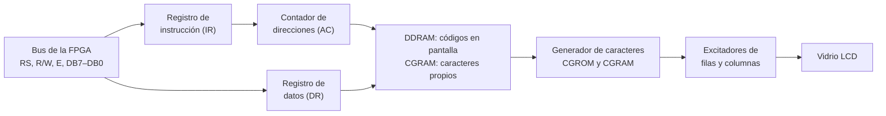
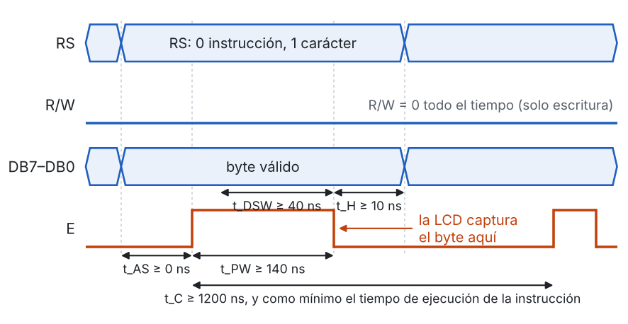
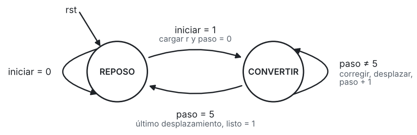
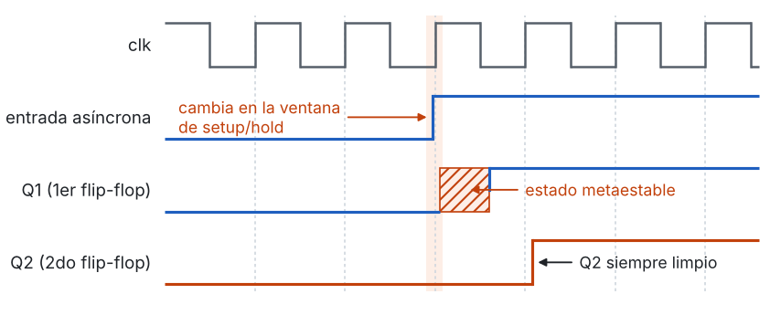

# Laboratorio 5 – Fundamentos: pantalla LCD 16x2, máquinas de estados y conversión a decimal

Este documento amplía el fundamento teórico de las guías de la [Parte 1](Parte1_Texto_Estatico.md) y la [Parte 2](Parte2_Texto_Dinamico.md). Las guías resumen lo necesario para cada actividad; aquí se explica con más detalle de dónde salen los valores, por qué el código base está organizado como está y qué técnicas sirven para modificarlo.

Los ejemplos numéricos usan valores **distintos** a los del laboratorio (otra frecuencia de reloj, otras instrucciones, otros números). El pre-informe se resuelve aplicando el mismo procedimiento a los valores del laboratorio.

Los códigos de ejemplo citados están en la carpeta [`ejemplos`](ejemplos).

| Parte | Secciones de apoyo |
|---|---|
| Parte 1: controlador y texto estático | 1 a 9, 12 a 14 |
| Parte 2: texto dinámico | 6, 7.3, 8 a 12 |

---

## Contenido

1. [La pantalla LCD de caracteres](#1-la-pantalla-lcd-de-caracteres)
2. [El controlador interno de la pantalla](#2-el-controlador-interno-de-la-pantalla)
3. [Las instrucciones](#3-las-instrucciones)
4. [Temporización de la interfaz](#4-temporización-de-la-interfaz)
5. [Inicialización](#5-inicialización)
6. [La memoria de la pantalla y la posición del cursor](#6-la-memoria-de-la-pantalla-y-la-posición-del-cursor)
7. [Caracteres y textos](#7-caracteres-y-textos)
8. [Unidad de control, ruta de datos y *handshake*](#8-unidad-de-control-ruta-de-datos-y-handshake)
9. [Máquinas de estados en Verilog](#9-máquinas-de-estados-en-verilog)
10. [Del número binario al texto](#10-del-número-binario-al-texto)
11. [Señales externas: sincronización y muestreo](#11-señales-externas-sincronización-y-muestreo)
12. [Simulación con el modelo de la pantalla](#12-simulación-con-el-modelo-de-la-pantalla)
13. [Interfaz eléctrica](#13-interfaz-eléctrica)
14. [Diagnóstico en la tarjeta](#14-diagnóstico-en-la-tarjeta)
15. [Referencias](#15-referencias)

---

## 1. La pantalla LCD de caracteres

### 1.1 Cómo se forma la imagen

Una pantalla de cristal líquido no emite luz: controla la luz que la atraviesa. El cristal líquido está entre dos vidrios con polarizadores. Cuando se aplica una tensión entre los electrodos de un punto, las moléculas del cristal cambian de orientación, la polarización de la luz cambia y el punto se ve oscuro. La pantalla del laboratorio es de tipo *positivo*: puntos oscuros sobre fondo claro.

Dos detalles explican varias de las especificaciones de la hoja de datos:

- **La tensión aplicada a cada punto debe ser alterna.** Una tensión continua degrada el cristal líquido. Por eso la pantalla no se maneja directamente desde la FPGA: un circuito excitador dentro del módulo genera las formas de onda alternas.
- **El cristal responde lento.** La hoja de datos indica tiempos de respuesta de 150 ms a 200 ms. Un cambio en la pantalla no se percibe antes de ese tiempo, sin importar qué tan rápido lo envíe la FPGA.

### 1.2 Matriz de puntos y multiplexado

Cada carácter es una matriz de 5 columnas por 8 filas de puntos. Con 16 caracteres por fila y dos filas, la pantalla tiene 80 columnas de puntos y 16 filas de puntos. Conectar cada punto por separado exigiría 1280 conexiones; en su lugar, la pantalla se **multiplexa**:

- las 16 filas de puntos (líneas *comunes*) se activan una a la vez, en secuencia;
- mientras una fila está activa, las 80 líneas de *segmento* indican qué puntos de esa fila se oscurecen.

La hoja de datos de la pantalla indica un ciclo de trabajo (*duty*) de 1/16: cada fila de puntos está activa la dieciseisava parte del tiempo, y la imagen completa se recorre 64 veces por segundo (*frame frequency*).

Este barrido lo hace el controlador del módulo, de forma continua y sin intervención de la FPGA. Por eso basta con escribir **una vez** el código de cada carácter: la pantalla lo sigue mostrando mientras tenga alimentación. Cuando en la Parte 2 se habla de *refrescar* la pantalla, se trata de actualizar el contenido (los códigos guardados), no de redibujar la imagen.

### 1.3 El módulo del laboratorio

La pantalla del laboratorio (Vishay LCD-016N002B-CFH-ET, [hoja de datos](lcd016n002bcfhet.pdf)) incluye:

| Elemento | Detalle |
|---|---|
| Controlador | ST7066U, compatible con el HD44780 de Hitachi |
| Formato | 16 caracteres x 2 filas, matriz de 5x8 puntos |
| Alimentación de la lógica | 4,5 V a 5,5 V (típico 5,0 V) |
| Tensión de excitación del cristal | V<sub>DD</sub> – V<sub>0</sub>, típica de 3,7 V a 25 °C |
| Retroiluminación | LED, pines 15 (ánodo) y 16 (cátodo) |
| Tabla de caracteres | Fuente inglesa y europea (sufijo ET de la referencia) |

El pin V<sub>0</sub> fija la tensión de excitación y, con ella, el **contraste**. En la tarjeta se ajusta con un potenciómetro: con muy poca tensión los puntos no se oscurecen y con demasiada se oscurecen también los puntos apagados.

---

## 2. El controlador interno de la pantalla

### 2.1 Registros y memorias

La FPGA no dibuja puntos: le envía bytes al controlador de la pantalla, que los interpreta. El siguiente diagrama muestra los bloques internos que intervienen en una escritura.



| Bloque | Función |
|---|---|
| Registro de instrucción (IR) | Recibe las instrucciones: borrar, configurar, mover el cursor |
| Registro de datos (DR) | Recibe los códigos de los caracteres que se van a guardar |
| Contador de direcciones (AC) | Indica en qué dirección de memoria se guarda el siguiente dato; se actualiza solo después de cada escritura |
| DDRAM (*Display Data RAM*) | Guarda el código de cada carácter que se muestra (80 posiciones) |
| CGROM (*Character Generator ROM*) | Contiene el dibujo de 5x8 puntos de cada código de la tabla de caracteres |
| CGRAM (*Character Generator RAM*) | Guarda hasta 8 dibujos definidos por el usuario |
| Bandera de ocupado (BF) | Indica que el controlador todavía ejecuta la instrucción anterior |

### 2.2 Selección del registro con RS y R/W

| RS | R/W | Operación |
|---|---|---|
| 0 | 0 | Escribir una instrucción en el IR |
| 0 | 1 | Leer la bandera de ocupado (DB7) y el contador de direcciones |
| 1 | 0 | Escribir un dato en la DDRAM o en la CGRAM |
| 1 | 1 | Leer un dato de la DDRAM o de la CGRAM |

En el laboratorio solo se usan las dos combinaciones de escritura (R/W = 0). La sección 13 explica por qué la FPGA nunca lee la pantalla.

### 2.3 Tiempo de ejecución y bandera de ocupado

Después de recibir un byte, el controlador tarda un tiempo en ejecutarlo: 39 µs para casi todas las instrucciones, 43 µs para guardar un carácter y 1,53 ms para Clear Display y Return Home. Mientras tanto ignora cualquier byte nuevo.

Hay dos formas de respetar ese tiempo:

1. **Leer la bandera de ocupado** hasta que valga 0. Es la forma más rápida, pero exige leer la pantalla (R/W = 1).
2. **Esperar un tiempo fijo**, mayor que el tiempo de ejecución. Es lo que hace el código base.

La hoja de datos da los tiempos de ejecución para una frecuencia típica del oscilador interno del controlador (270 kHz). Ese oscilador varía con la tensión de alimentación y la temperatura, y si es más lento las instrucciones tardan más. Por eso las esperas fijas deben tener **margen** sobre los valores de la tabla.

---

## 3. Las instrucciones

### 3.1 Cómo reconocer una instrucción

Cada instrucción es un byte con RS = 0. La instrucción se identifica por la **posición del 1 más significativo**; los bits a la derecha de ese 1 son sus parámetros.

| 1 más significativo en | Instrucción | Parámetros |
|---|---|---|
| DB0 | Clear Display | — |
| DB1 | Return Home | — |
| DB2 | Entry Mode Set | I/D (incrementar o decrementar), S (desplazar la pantalla) |
| DB3 | Display ON/OFF Control | D (pantalla), C (cursor), B (parpadeo) |
| DB4 | Cursor or Display Shift | S/C (pantalla o cursor), R/L (derecha o izquierda) |
| DB5 | Function Set | DL (8 o 4 bits), N (2 o 1 líneas), F (5x11 o 5x8 puntos) |
| DB6 | Set CGRAM Address | dirección de 6 bits |
| DB7 | Set DDRAM Address | dirección de 7 bits |

Los bits marcados como "no importa" en la tabla de instrucciones se envían en 0.

### 3.2 Ejemplos de lectura

| Byte | Binario | Instrucción | Lectura de los parámetros |
|---|---|---|---|
| 0x0F | `0000 1111` | Display ON/OFF | D = 1: pantalla encendida; C = 1: cursor visible; B = 1: el cursor parpadea |
| 0x0E | `0000 1110` | Display ON/OFF | Pantalla encendida, cursor visible, sin parpadeo |
| 0x07 | `0000 0111` | Entry Mode Set | I/D = 1: el AC se incrementa; S = 1: toda la pantalla se desplaza con cada carácter, de modo que el texto parece avanzar |
| 0x18 | `0001 1000` | Cursor or Display Shift | S/C = 1: desplaza la pantalla; R/L = 0: hacia la izquierda. La DDRAM no cambia |
| 0x14 | `0001 0100` | Cursor or Display Shift | S/C = 0: mueve el cursor; R/L = 1: una posición a la derecha |
| 0x28 | `0010 1000` | Function Set | DL = 0: bus de **4 bits**; N = 1: dos líneas; F = 0: 5x8. No sirve para la tarjeta del curso, que conecta las 8 líneas de datos |
| 0x48 | `0100 1000` | Set CGRAM Address | Dirección 0x08 de la CGRAM: primera fila del carácter personalizado número 1 |
| 0xC5 | `1100 0101` | Set DDRAM Address | Dirección 0x45: fila 2, columna 5 (sección 6.3) |

### 3.3 Cómo armar una instrucción

1. Escoger la instrucción en la tabla de la sección 11 de la hoja de datos.
2. Escribir el patrón fijo de la instrucción: ceros a la izquierda y el 1 que la identifica.
3. Decidir el valor de cada parámetro, bit por bit.
4. Poner en 0 los bits que no importan.
5. Convertir a hexadecimal y comprobar leyendo el byte como en la sección 3.2.

Ejemplo: mover el cursor una posición a la izquierda.

- Instrucción: Cursor or Display Shift, patrón `0001 xx--`.
- S/C = 0 (mover el cursor, no la pantalla); R/L = 0 (izquierda).
- Byte: `0001 0000` = 0x10.

---

## 4. Temporización de la interfaz

### 4.1 El flanco de bajada de E

Para la pantalla, el flanco de bajada de E cumple el mismo papel que el flanco de reloj de un flip-flop: en ese instante captura RS y el byte del bus. Por eso los tiempos de la hoja de datos se parecen a los de un flip-flop:

| Parámetro | Símbolo | Mínimo | Equivalente en un flip-flop |
|---|---|---|---|
| Dato estable antes de bajar E | t<sub>DSW</sub> | 40 ns | Tiempo de *setup* |
| Dato estable después de bajar E | t<sub>H</sub> | 10 ns | Tiempo de *hold* |
| RS y R/W listos antes de subir E | t<sub>AS</sub> | 0 ns | — |
| Ancho del pulso E | t<sub>PW</sub> | 140 ns | Ancho mínimo del pulso de reloj |
| Ciclo de E | t<sub>C</sub> | 1200 ns | Periodo mínimo del reloj |

<p align="center">
 
</p>
<p align="center">
 Figura 1: Ciclo de escritura (hoja de datos, sección 12.1)
</p>

Una consecuencia importante: **cualquier flanco de bajada de E produce una escritura**. Un pulso espurio de unos pocos nanosegundos en E (un *glitch*) puede guardar un byte que no se quería enviar. La sección 9.4 muestra cómo se evita.

### 4.2 Tiempo de escritura y tiempo de ejecución

El ciclo de E dura como mínimo 1,2 µs, pero la siguiente escritura no puede empezar hasta que el controlador termine de ejecutar la anterior (sección 2.3). Como 43 µs es unas 35 veces más que 1,2 µs, el ritmo de escritura lo marca la ejecución:

$$t_{\text{escritura}} = t_{\text{preparación}} + t_{\text{pulso E}} + t_{\text{espera de ejecución}}$$

El tiempo total de una secuencia se obtiene sumando la espera de encendido y el tiempo de cada escritura.

### 4.3 De tiempos a ciclos de reloj

En la FPGA, un intervalo se genera contando ciclos de reloj. Con un reloj de frecuencia *f*<sub>clk</sub>:

$$N = \left\lceil t \cdot f_{clk} \right\rceil \qquad \text{bits del contador} = \left\lceil \log_2 N \right\rceil$$

- Se redondea **hacia arriba**, porque los tiempos de la hoja de datos son mínimos.
- Un contador que cuenta de 0 a *N* – 1 necesita los bits para representar *N* – 1; en Verilog, `$clog2(N)` da justamente ese número.
- Si un mismo contador mide varios intervalos (por ejemplo, una espera corta y una larga), su ancho lo fija el mayor.

El **margen** indica cuánto sobra respecto al mínimo:

$$\text{margen} = \frac{t_{\text{usado}} - t_{\text{mínimo}}}{t_{\text{mínimo}}}$$

Ejemplo con un reloj de **25 MHz** (periodo de 40 ns) y unos tiempos elegidos para ilustrar el cálculo:

| Intervalo | Tiempo elegido | Mínimo de la hoja de datos | Ciclos a 25 MHz | Bits | Margen |
|---|---|---|---|---|---|
| Pulso de E | 400 ns | 140 ns | 10 | 4 | 186 % |
| Ejecución corta | 60 µs | 43 µs | 1 500 | 11 | 40 % |
| Ejecución larga | 2,5 ms | 1,53 ms | 62 500 | 16 | 63 % |
| Espera de encendido | 60 ms | 40 ms | 1 500 000 | 21 | 50 % |

La espera corta se compara con 43 µs, el mayor de los tiempos cortos, porque una sola espera sirve para instrucciones y caracteres.

### 4.4 El sintetizador hace las cuentas

En el código base los tiempos se escriben a partir del parámetro `CLK_FREQ`:

```verilog
localparam CICLOS_US = CLK_FREQ / 1_000_000;   // ciclos en 1 µs
localparam T_CORTA   = 50 * CICLOS_US;
localparam W         = $clog2(T_LARGA);
```

Estas divisiones y multiplicaciones entre parámetros las calcula el sintetizador una sola vez: el circuito resultante solo contiene contadores y comparadores con constantes, no divisores. La ventaja es que el mismo código funciona con otra frecuencia de reloj cambiando un solo valor.

---

## 5. Inicialización

### 5.1 Por qué hay que inicializar la pantalla

El controlador tiene un circuito de reinicio interno que se activa al encender la alimentación, pero solo funciona bien si la tensión sube lo bastante rápido. Como esa condición no se puede garantizar, la hoja de datos indica una **inicialización por instrucciones**: una secuencia que deja al controlador en un estado conocido sin importar cómo arrancó.

La secuencia (Parte 1, sección 2.6) tiene tres momentos:

1. **Esperar a que el controlador arranque** (más de 40 ms después de encender). Antes de eso, cualquier byte se pierde.
2. **Configurar la interfaz** con Function Set: ancho del bus, número de líneas y tamaño de los caracteres. La hoja de datos pide enviarlo dos veces; repetirlo asegura que la configuración quede aplicada aunque el controlador no haya atendido la primera escritura.
3. **Dejar la pantalla lista para escribir**: encenderla (después del arranque está apagada), borrarla (la DDRAM puede tener cualquier contenido) y fijar cómo avanza el cursor.

Otros controladores compatibles, como el HD44780 original, piden una secuencia más conservadora: Function Set tres veces, con esperas de más de 4,1 ms y de más de 100 µs entre ellas. Si una pantalla de otro fabricante no inicializa con la secuencia del laboratorio, esa es la primera variante que conviene probar.

### 5.2 Cómo saber si la inicialización falló

Una pantalla con alimentación y contraste ajustado, pero sin inicializar, muestra la **primera fila como 16 bloques oscuros** y la segunda vacía: el controlador sigue en su configuración de arranque, de una sola línea, y con el contraste ajustado para dos líneas todos los puntos de esa línea se ven oscuros. Ver esos bloques indica que la alimentación y el contraste están bien y que el problema está en las señales o en los tiempos (sección 14).

---

## 6. La memoria de la pantalla y la posición del cursor

### 6.1 La DDRAM y la ventana visible

En modo de dos líneas, la DDRAM tiene 40 posiciones por fila: 0x00 a 0x27 para la primera y 0x40 a 0x67 para la segunda. La pantalla muestra solo las primeras 16 de cada fila.

<p align="center">
 
</p>
<p align="center">
 Figura 2: Direcciones de la DDRAM en modo de dos líneas y ventana visible de una pantalla 16x2
</p>

Dos consecuencias prácticas:

- **Escribir más de 16 caracteres seguidos no pasa a la segunda fila.** Los caracteres 17 en adelante se guardan en direcciones que no se ven (0x10, 0x11, …). Para escribir en la segunda fila se ubica el cursor con Set DDRAM Address.
- **Las posiciones ocultas no se pierden.** Con la instrucción de desplazamiento de la pantalla (S/C = 1) la ventana visible se mueve y muestra esas posiciones; así se hacen los textos que se desplazan.

### 6.2 El contador de direcciones y el modo de entrada

El AC indica dónde se guarda el siguiente carácter. Después de cada escritura de un dato, el controlador lo actualiza según Entry Mode Set:

- I/D = 1: el AC aumenta y el texto se escribe de izquierda a derecha.
- I/D = 0: el AC disminuye y el texto se escribe de derecha a izquierda.

Por eso una fila completa se escribe enviando una sola instrucción de posición seguida de los caracteres, sin indicar la dirección de cada uno.

### 6.3 Ubicar el cursor

La instrucción Set DDRAM Address tiene un 1 en DB7 y la dirección en DB6 a DB0:

$$\text{instrucción} = \texttt{0x80} + \text{dirección}, \qquad \text{dirección} = \begin{cases} \texttt{0x00} + \text{columna} & \text{fila 1} \\ \texttt{0x40} + \text{columna} & \text{fila 2} \end{cases}$$

con las columnas numeradas desde 0. Ejemplos:

| Posición | Dirección | Instrucción | Binario |
|---|---|---|---|
| Fila 1, columna 9 | 0x09 | 0x89 | `1000 1001` |
| Fila 2, columna 5 | 0x45 | 0xC5 | `1100 0101` |
| Fila 2, columna 15 | 0x4F | 0xCF | `1100 1111` |

En binario se ve una regularidad útil: el bit DB6 indica la fila y los bits DB3 a DB0 la columna. La función `dir_ddram` de [`ejemplos/funciones_lcd.v`](ejemplos/funciones_lcd.v) arma la instrucción concatenando esos campos.

---

## 7. Caracteres y textos

### 7.1 La tabla de caracteres

Cuando se escribe un dato, el controlador guarda su código en la DDRAM y la CGROM lo convierte en un dibujo de 5x8 puntos. La correspondencia entre códigos y dibujos está en la *Table 2* de la hoja de datos (sección 10):

- la **columna** de la tabla corresponde a los 4 bits altos del código;
- la **fila** corresponde a los 4 bits bajos.

Por ejemplo, la letra `A` está en la columna `0100` y la fila `0001`: su código es `0100 0001` = 0x41.

Entre 0x20 y 0x7D los códigos coinciden con ASCII (letras, dígitos y signos comunes), así que en Verilog se pueden escribir directamente como texto entre comillas. Los códigos 0x00 a 0x0F muestran los caracteres de la CGRAM, y los códigos altos contienen símbolos y letras acentuadas que dependen del modelo de pantalla. Para el laboratorio el texto se escribe **sin tildes ni ñ**; si un grupo quiere usar otro símbolo, debe buscar su código en la tabla y comprobarlo en la pantalla.

### 7.2 Caracteres personalizados (CGRAM)

La CGRAM guarda hasta 8 caracteres definidos por el usuario. Cada carácter ocupa 8 bytes, uno por fila de puntos; en cada byte solo se usan los 5 bits bajos, y un 1 enciende el punto.

<p align="center">
 
</p>
<p align="center">
 Figura 3: Un carácter personalizado: dibujo, bytes y direcciones en la CGRAM (carácter 0)
</p>

El carácter número *n* (0 a 7) ocupa las direcciones 8·*n* a 8·*n* + 7 de la CGRAM. Para definirlo y mostrarlo:

1. Enviar Set CGRAM Address con la dirección 8·*n*: instrucción 0x40 + 8·*n*.
2. Enviar los 8 bytes del dibujo como datos (RS = 1); el AC avanza solo.
3. Enviar Set DDRAM Address para volver a la pantalla. Sin este paso, los caracteres siguientes se guardarían en la CGRAM.
4. Escribir el código *n* como cualquier otro carácter.

Para el carácter 1, por ejemplo, la secuencia empieza con 0x48 (sección 3.2) y el carácter se muestra escribiendo el código 0x01. El modelo de simulación guarda la CGRAM y muestra los caracteres personalizados como `*` en la consola.

### 7.3 Textos en Verilog

Una cadena entre comillas es un vector con los códigos ASCII de sus caracteres, 8 bits por carácter y con el **primer carácter en los bits más significativos**:

```verilog
localparam [8*4-1:0] SALUDO = "Hola";
// SALUDO[31:24] = "H" = 8'h48
// SALUDO[23:16] = "o" = 8'h6F
// SALUDO[15:8]  = "l" = 8'h6C
// SALUDO[7:0]   = "a" = 8'h61
```

Para leer el carácter número *c* de un texto de *L* caracteres (contando desde 0 a la izquierda) se usa una **selección indexada** de 8 bits:

```verilog
texto[8*(L-1-c) +: 8]     // 8 bits a partir del bit 8*(L-1-c), hacia arriba
```

El operador `+:` permite que la posición inicial sea una señal (por ejemplo, un contador de columna), siempre que el ancho sea constante. El sintetizador lo convierte en un multiplexor.

**Cuidado con la longitud.** Si la cadena tiene menos caracteres que el vector, Verilog completa con **ceros a la izquierda**. Para la pantalla, el código 0x00 no es un espacio: es el carácter personalizado número 0, que puede mostrar cualquier dibujo. Por eso los textos del laboratorio deben tener exactamente 16 caracteres, completando con espacios.

```verilog
localparam [8*16-1:0] MAL  = "Hola";               // 12 bytes 0x00 y luego "Hola"
localparam [8*16-1:0] BIEN = "Hola            ";   // "Hola" y 12 espacios (0x20)
```

**Textos más largos.** Para muchos textos o mensajes largos, en lugar de un vector se puede usar una pequeña memoria de solo lectura descrita con `case`, o una memoria inicializada desde un archivo con `$readmemh`, que Quartus acepta para inicializar memorias.

---

## 8. Unidad de control, ruta de datos y *handshake*

### 8.1 Dos partes de un sistema digital

Un sistema que ejecuta una secuencia de pasos se divide en:

- **Ruta de datos:** registros, contadores, memorias, multiplexores y operadores. Guarda y transforma los datos.
- **Unidad de control:** una máquina de estados que decide qué hace la ruta de datos en cada momento.

Las dos partes se comunican con dos tipos de señales:

| Tipo | Sentido | Ejemplos |
|---|---|---|
| Señales de control | Unidad de control → ruta de datos | Cargar un registro, incrementar un contador, elegir la entrada de un multiplexor |
| Señales de estado | Ruta de datos → unidad de control | "El contador llegó al final", "el dato es cero" |

Para dibujar la arquitectura de un código existente conviene recorrerlo buscando: cada `reg` que se actualiza en un `always @(posedge clk)` (registro o contador), cada `case` o `?:` que elige un valor (multiplexor), cada comparación usada como condición de transición (señal de estado) y cada señal que depende del estado y modifica la ruta de datos (señal de control).

### 8.2 Un módulo por tarea

Cuando una tarea se repite muchas veces, conviene encapsularla en un módulo con su propia máquina de estados. Así cada máquina tiene pocos estados y una sola responsabilidad. En el código base:

- `lcd_escritura` sabe **cómo** se escribe un byte en la pantalla (tiempos, pulso de E), pero no sabe qué byte enviar.
- `lcd_ctrl` sabe **qué** bytes enviar y en qué orden, pero no cómo se genera el pulso de E.

Si mañana la pantalla cambiara de interfaz, solo habría que cambiar el módulo de escritura.

### 8.3 *Handshake*: pedir y avisar

Dos máquinas que trabajan juntas necesitan un protocolo para coordinarse. El esquema más simple usa dos señales:

- **`iniciar`** (del maestro al trabajador): un pulso de un ciclo que pide una tarea. Los datos de entrada deben estar listos en ese mismo ciclo.
- **`listo`** (del trabajador al maestro): un pulso de un ciclo que avisa que la tarea terminó.

<p align="center">
 
</p>
<p align="center">
 Figura 4: Handshake con pulsos de un ciclo entre una máquina maestra y una trabajadora
</p>

Reglas del protocolo:

1. El maestro pone el dato y da el pulso de `iniciar` en el mismo ciclo.
2. El trabajador captura el dato en ese flanco y lo guarda en sus propios registros: desde ese momento el maestro puede cambiar el dato sin afectar la tarea en curso.
3. El maestro no pide otra tarea hasta recibir `listo`.
4. El trabajador da el pulso de `listo` solo cuando la tarea está completa.

El ejemplo [`ejemplos/bin6_a_bcd_sec.v`](ejemplos/bin6_a_bcd_sec.v) aplica este protocolo a una conversión numérica, y su testbench muestra cómo manejarlo desde la simulación.

Existen variantes con señales de nivel en lugar de pulsos (por ejemplo, petición y reconocimiento que se mantienen hasta que el otro lado responde). Se usan cuando los dos módulos tienen relojes distintos; dentro de un mismo dominio de reloj, los pulsos de un ciclo son suficientes y más simples.

---

## 9. Máquinas de estados en Verilog

### 9.1 Estructura en tres bloques

El código base describe cada máquina de estados (tipo Moore) en tres bloques, cada uno con una sola función:

```verilog
localparam A = 2'd0, B = 2'd1, C = 2'd2;
reg [1:0] estado, siguiente;

// 1. Registro de estado: lo único que guarda el estado
always @(posedge clk)
    if (rst) estado <= A;
    else     estado <= siguiente;

// 2. Lógica de siguiente estado: combinacional
always @(*) begin
    siguiente = estado;                  // por defecto, quedarse
    case (estado)
        A: if (x)      siguiente = B;
        B: if (y)      siguiente = C;
           else if (z) siguiente = A;
        C:             siguiente = A;
        default:       siguiente = A;
    endcase
end

// 3. Lógica de salida, registrada
always @(posedge clk)
    if (rst) s <= 1'b0;
    else     s <= (siguiente == B);      // s vale 1 mientras la máquina está en B
```

| Bloque | Tipo de `always` | Asignación | Contenido |
|---|---|---|---|
| Registro de estado | `@(posedge clk)` | `<=` (no bloqueante) | Reset y `estado <= siguiente` |
| Siguiente estado | `@(*)` | `=` (bloqueante) | Un `case` con las transiciones y sus condiciones |
| Salidas | `@(posedge clk)` o `@(*)` | según el tipo | Valor de cada salida en cada estado |

### 9.2 Del código al diagrama

Para obtener el diagrama de estados de un código existente:

1. Los **estados** son las constantes `localparam` que toma el registro de estado.
2. Las **transiciones** están en el bloque de siguiente estado: cada `if` dentro de un caso es una flecha, y su condición es la etiqueta. El valor por defecto (`siguiente = estado`) es la flecha que vuelve al mismo estado cuando no se cumple ninguna condición.
3. Las **acciones** de la ruta de datos se buscan en los bloques que preguntan por el estado (`if (estado == ...)`).
4. El **estado inicial** es el que se asigna en el reset.

Ejemplo con el convertidor secuencial de [`ejemplos/bin6_a_bcd_sec.v`](ejemplos/bin6_a_bcd_sec.v):

<p align="center">
 
</p>
<p align="center">
 Figura 5: Diagrama de estados de bin6_a_bcd_sec.v. Encima de cada flecha, la condición; debajo, en gris, la acción en la ruta de datos
</p>

| Estado actual | Condición | Siguiente estado | Acción en la ruta de datos |
|---|---|---|---|
| REPOSO | `iniciar = 0` | REPOSO | — |
| REPOSO | `iniciar = 1` | CONVERTIR | `r ← {0, bin}`, `paso ← 0` |
| CONVERTIR | `paso ≠ 5` | CONVERTIR | `r ← corregir(r) << 1`, `paso ← paso + 1` |
| CONVERTIR | `paso = 5` | REPOSO | `r ← corregir(r) << 1`, `listo ← 1` |

`paso = 5` es una señal de estado (sale de la ruta de datos hacia la unidad de control) y "cargar `r`" es una acción que la unidad de control ordena a la ruta de datos.

### 9.3 Estados con duración

Muchos estados deben durar un tiempo fijo. Un patrón simple es un contador que vuelve a cero **cada vez que la máquina cambia de estado**:

```verilog
always @(posedge clk)
    if (rst || estado != siguiente) cuenta <= 0;   // al cambiar de estado, empezar de cero
    else                            cuenta <= cuenta + 1'b1;

wire fin_espera = (cuenta == MAX_ESPERA);           // señal de estado
```

y una transición que depende de esa señal:

```verilog
ESPERAR: if (fin_espera) siguiente = OTRO_ESTADO;
```

Como el contador arranca en cero justo al entrar al estado, la espera dura exactamente `MAX_ESPERA + 1` ciclos.

La alternativa es una base de tiempo que corre libre ([`ejemplos/base_tiempo.v`](ejemplos/base_tiempo.v)) y una transición `if (tick)`. Es más simple, pero la espera queda entre 0 y un periodo completo, porque el pulso llega en cualquier momento respecto a la entrada al estado. Sirve para acciones periódicas en las que la fase no importa; **no** sirve para los tiempos mínimos de la hoja de datos.

### 9.4 Salidas registradas y *glitches*

Una salida calculada con lógica combinacional a partir del estado (por ejemplo, `assign s = (estado == B);`) puede tener pulsos espurios de unos nanosegundos cuando varios bits del estado cambian a la vez y no llegan al mismo tiempo a la compuerta. En la mayoría de las señales esto no importa, porque se leen en el siguiente flanco de reloj. En E sí importa: para la pantalla, un pulso espurio es un flanco de bajada y produce una escritura (sección 4.1).

Una salida que sale directamente de un flip-flop no tiene *glitches*. El inconveniente es que, si se registra `(estado == B)`, la salida aparece un ciclo después de entrar al estado. Registrar `(siguiente == B)` evita ese retraso: en el flanco en que el estado pasa a B, la salida toma el valor de B al mismo tiempo.

### 9.5 Errores frecuentes

| Error | Consecuencia | Cómo evitarlo |
|---|---|---|
| En un `always @(*)`, una señal no recibe valor en todos los caminos | Se infiere un *latch* (Quartus: advertencia 10240, *inferring latch(es)*) | Asignar un valor por defecto al comienzo del bloque |
| Un `case` sin `default` | Estados no usados sin salida definida | Agregar `default` que lleve a un estado seguro |
| La misma señal asignada en dos bloques `always` | Error de múltiples manejadores (Quartus: error 10028) | Cada señal se asigna en un solo bloque |
| `=` en un bloque con reloj o `<=` en uno combinacional | Simulación distinta del hardware | `<=` con reloj, `=` combinacional |
| Constante o suma más ancha que el registro | Truncamiento (Quartus: advertencia 10230) | Revisar los anchos; calcularlos con `$clog2` |
| Una señal generada por lógica usada como reloj (`@(posedge tick)`) | Retardos no controlados, comportamiento distinto en la tarjeta | Usar `clk` en todo el diseño y la señal como habilitación |

### 9.6 Verificar el diagrama con Quartus

Después de compilar, *Tools → Netlist Viewers → State Machine Viewer* muestra las máquinas de estados que Quartus reconoce en el diseño, con sus estados y transiciones. Es una buena forma de comprobar que el diagrama de la bitácora coincide con lo que se sintetizó.

---

## 10. Del número binario al texto

### 10.1 Cifras decimales y BCD

Para mostrar un número en decimal, cada cifra se envía como un carácter distinto. Primero hay que separar el número en sus cifras. Cuando cada cifra se guarda en 4 bits, la representación se llama **BCD** (*Binary-Coded Decimal*):

| Número | Binario | BCD |
|---|---|---|
| 9 | `1001` | `1001` |
| 10 | `1010` | `0001 0000` |
| 57 | `0011 1001` | `0101 0111` |
| 157 | `1001 1101` | `0001 0101 0111` |

El número de cifras depende del mayor valor posible: con *n* bits el mayor valor es 2<sup>*n*</sup> – 1. Por ejemplo, con 6 bits es 63 (dos cifras) y con 10 bits es 1023 (cuatro cifras).

### 10.2 Algoritmo *double dabble*

El algoritmo usa un registro con un grupo de 4 bits por cada cifra y, a la derecha, el número binario. Se repite una vez por cada bit del número:

1. **Corregir:** a cada grupo BCD que valga 5 o más se le suma 3.
2. **Desplazar:** todo el registro se desplaza un bit a la izquierda.

**¿Por qué sumar 3?** Desplazar a la izquierda multiplica por 2. Un grupo que vale 5 o más llegaría a 10 o más, que no es una cifra decimal. Ejemplo con un grupo que vale 6:

- Sin corregir: `0110` → `1100` (12 en un solo grupo: no es BCD).
- Corrigiendo: `0110` + `0011` = `1001` → al desplazar, sale un 1 hacia el grupo siguiente y queda `0010`. Resultado: decena 1, unidad 2, es decir, 12 en BCD.

Sumar 3 antes de duplicar equivale a sumar 6 después, y 6 es la diferencia entre 16 (donde un grupo de 4 bits pasa acarreo) y 10 (donde debería pasarlo una cifra decimal).

Ejemplo completo con 157 (`1001 1101`), 8 iteraciones:

| Iteración | Operación | Centenas | Decenas | Unidades | Binario |
|---|---|---|---|---|---|
| 0 | Valor inicial | 0000 | 0000 | 0000 | 10011101 |
| 1 | Desplazar | 0000 | 0000 | 0001 | 00111010 |
| 2 | Desplazar | 0000 | 0000 | 0010 | 01110100 |
| 3 | Desplazar | 0000 | 0000 | 0100 | 11101000 |
| 4 | Desplazar | 0000 | 0000 | 1001 | 11010000 |
| 5 | Sumar 3 a unidades | 0000 | 0000 | 1100 | 11010000 |
| 5 | Desplazar | 0000 | 0001 | 1001 | 10100000 |
| 6 | Sumar 3 a unidades | 0000 | 0001 | 1100 | 10100000 |
| 6 | Desplazar | 0000 | 0011 | 1001 | 01000000 |
| 7 | Sumar 3 a unidades | 0000 | 0011 | 1100 | 01000000 |
| 7 | Desplazar | 0000 | 0111 | 1000 | 10000000 |
| 8 | Sumar 3 a unidades | 0000 | 0111 | 1011 | 10000000 |
| 8 | Sumar 3 a decenas | 0000 | 1010 | 1011 | 10000000 |
| 8 | Desplazar | **0001** | **0101** | **0111** | 00000000 |

Resultado: 1, 5, 7.

En cada iteración la corrección se revisa en **todos** los grupos BCD, empezando por cualquiera: en un mismo paso cada grupo se corrige por separado, con su propio valor.

### 10.3 Combinacional o secuencial

| | Combinacional | Secuencial |
|---|---|---|
| Descripción | Un `for` de límites fijos dentro de `always @(*)`; el sintetizador lo desenrolla en una etapa por iteración | Una iteración por ciclo de reloj, con un registro de desplazamiento y un contador |
| Tiempo | El resultado está disponible en el mismo ciclo | Tarda un ciclo por bit, más la carga |
| Lógica | Repite los correctores en cada etapa | Un solo juego de correctores, más registros y control |
| Interfaz | Entradas y salidas directas | Necesita `iniciar` y `listo` |
| Conviene | Para pocos bits | Para muchos bits |

Las dos versiones están en [`ejemplos/bin6_a_bcd.v`](ejemplos/bin6_a_bcd.v) y [`ejemplos/bin6_a_bcd_sec.v`](ejemplos/bin6_a_bcd_sec.v), para 6 bits.

Otras alternativas son una tabla de búsqueda (`case` con un resultado por cada valor de entrada, práctica para pocos bits) o divisiones y restos (`/ 10`, `% 10`). Los operadores `/` y `%` son sintetizables con constantes, pero producen bastante lógica combinacional; en un testbench, en cambio, son la forma más simple de calcular el resultado esperado.

### 10.4 De la cifra al carácter

En la tabla de caracteres, las cifras `0` a `9` tienen los códigos 0x30 a 0x39. Como una cifra BCD nunca pasa de 9, el código se forma poniendo `0011` en los 4 bits altos:

```verilog
codigo = {4'h3, cifra};          // equivale a 8'h30 + cifra
```

Para cifras hexadecimales hay un salto: después de `9` (0x39) la letra `A` está en 0x41, así que para los valores 10 a 15 se suma 0x37 en lugar de 0x30 (función `ascii_hex` de [`ejemplos/funciones_lcd.v`](ejemplos/funciones_lcd.v)).

Para suprimir los ceros a la izquierda (mostrar `  7` en lugar de `007`), se reemplaza el código de una cifra por el de un espacio (0x20) cuando esa cifra y todas las anteriores son cero. La cifra de las unidades se muestra siempre.

---

## 11. Señales externas: sincronización y muestreo

### 11.1 Metaestabilidad y sincronizador

Un interruptor puede cambiar en cualquier instante respecto al reloj. Si cambia justo en la ventana de *setup* y *hold* de un flip-flop, la salida del flip-flop puede quedar un tiempo en un valor intermedio, ni 0 ni 1, antes de decidirse: es la **metaestabilidad**.

<p align="center">
 
</p>
<p align="center">
 Figura 6: Un cambio en la ventana de setup y hold deja metaestable al primer flip-flop
</p>

La solución estándar es un **sincronizador de dos flip-flops**: el primero puede quedar metaestable, pero tiene casi un ciclo de reloj completo para resolverse antes de que el segundo lo capture. La probabilidad de que la metaestabilidad llegue a la salida del segundo es tan baja que en la práctica se desprecia.

<p align="center">
 
</p>
<p align="center">
 Figura 7: Sincronizador de dos flip-flops (<a href="ejemplos/sincronizador.v">ejemplos/sincronizador.v</a>)
</p>

Reglas de uso:

- Cada entrada asíncrona pasa por su sincronizador **antes** de llegar a cualquier otra lógica.
- La señal sin sincronizar no se usa en ningún otro lugar.
- Para un grupo de interruptores independientes basta con sincronizar cada bit. No sirve para un bus cuyos bits cambian a la vez y deben leerse juntos (como un contador de otro reloj).

### 11.2 ¿Hace falta antirrebote?

Los interruptores mecánicos rebotan durante algunos milisegundos al cambiar de posición. Que eso importe depende del uso:

- Si se **cuentan eventos** (por ejemplo, pulsaciones de un botón), cada rebote parece un evento nuevo y hace falta un circuito antirrebote.
- Si solo se **muestra el valor** periódicamente, un rebote puede hacer que una actualización muestre el valor anterior, pero la siguiente ya muestra el valor final. No hace falta antirrebote.

### 11.3 Coherencia: muestrear antes de escribir

Escribir las cifras de un número en la pantalla toma varias escrituras. Si el número cambia en medio de ellas, la pantalla puede mostrar cifras de dos valores distintos. Por ejemplo, si un contador pasa de 59 a 60 justo después de escribir las decenas, la pantalla muestra `50` hasta la siguiente actualización.

La solución es **muestrear**: copiar el valor en un registro antes de empezar a escribir y tomar todas las cifras de esa copia, que no cambia durante la escritura.

```verilog
always @(posedge clk)
    if (rst)            copia <= 0;
    else if (muestrear) copia <= valor;   // muestrear: pulso de un ciclo antes de escribir
```

---

## 12. Simulación con el modelo de la pantalla

### 12.1 Qué es un modelo de comportamiento

[`test/modelo_lcd.v`](test/modelo_lcd.v) no es un circuito: es un programa en Verilog que imita lo que hace la pantalla. Usa construcciones que no se sintetizan (variables `real`, `$realtime`, `$display`) para medir los tiempos de las señales en nanosegundos y reportar cualquier violación de la hoja de datos.

El modelo:

- captura un byte en cada flanco de bajada de E;
- interpreta las instrucciones y guarda los caracteres en una DDRAM y una CGRAM;
- revisa los tiempos y cuenta los errores;
- muestra en la consola lo que se vería en la pantalla.

No modela el desplazamiento de la pantalla (la ventana visible no se mueve) ni dibuja los caracteres personalizados.

### 12.2 Mensajes del modelo

| Mensaje | Significado |
|---|---|
| `escritura antes de 40 ms desde el encendido` | La espera de encendido es más corta que la de la hoja de datos |
| `escritura mientras la instruccion anterior se ejecuta` | La espera de ejecución es más corta que el tiempo de la instrucción anterior; el mensaje indica cuánto faltaba |
| `pulso E de ... ns (minimo 140 ns)` | Pulso de E demasiado angosto |
| `ciclo de E de ... ns (minimo 1200 ns)` | Dos pulsos de E demasiado seguidos |
| `RS o dato cambiaron ... ns antes de bajar E` | RS o el byte cambiaron muy cerca del flanco de bajada de E |
| `R/W debe ser 0` | Se intentó una lectura |
| `RS o dato indefinidos (x/z)` | Señales sin valor: falta un reset o una conexión |
| `se escribio un caracter antes de configurar la pantalla` | Llegó un dato antes de Function Set con 8 bits y 2 líneas |
| `Function Set en modo 4 bits` | DL = 0 en Function Set |

### 12.3 Uso desde el testbench

El testbench puede leer el estado del modelo con nombres jerárquicos (instancia `lcd`):

| Elemento | Uso |
|---|---|
| `lcd.caracter(fila, columna)` | Código del carácter visible en esa posición (filas y columnas desde 0) |
| `lcd.imprimir_pantalla` | Muestra la pantalla en la consola |
| `lcd.errores` | Número de errores de tiempo o de protocolo |
| `lcd.escrituras` | Número de bytes recibidos |

[`test/tb_lcd.v`](test/tb_lcd.v) compara filas completas; [`ejemplos/tb_revisar_pantalla.v`](ejemplos/tb_revisar_pantalla.v) muestra cómo revisar un campo de la pantalla y cómo esperar un número de escrituras.

### 12.4 Qué se puede acelerar en la simulación

El modelo mide tiempos reales. Por eso:

- `CLK_FREQ` debe coincidir con el reloj que genera el testbench. Si no coinciden, las esperas calculadas en ciclos duran otro tiempo real y el modelo reporta errores.
- Las esperas que exige la hoja de datos no se pueden acortar: la inicialización siempre toma unos 50 ms de tiempo simulado.
- Lo que sí se reduce son los tiempos propios del diseño, como el periodo de refresco de la Parte 2 (`T_REFRESCO_MS`): con 100 ms, probar cuatro pares de valores exigiría casi medio segundo de tiempo simulado.

Al probar un módulo sin el modelo (un convertidor, una base de tiempo) sí se puede usar una frecuencia de reloj menor, como en [`ejemplos/tb_base_tiempo.v`](ejemplos/tb_base_tiempo.v).

### 12.5 Consejos para GTKWave

- Guardar en el archivo VCD solo las señales necesarias (`$dumpvars` con una lista de señales, como en `tb_lcd.v`): con el reloj de 50 MHz y decenas de milisegundos, el archivo crece mucho.
- Mostrar `lcd_data` en hexadecimal, `estado` en decimal y, si ayuda, `lcd_data` también como ASCII (*Data Format* en el menú contextual de la señal).
- Medir tiempos con los marcadores de GTKWave, entre los flancos de interés.
- Guardar la configuración de la vista (*File → Write Save File*) para no repetirla después de cada simulación.

---

## 13. Interfaz eléctrica

### 13.1 Niveles lógicos y márgenes de ruido

Una salida y una entrada son compatibles si los niveles que garantiza la salida caen dentro de los que acepta la entrada:

| Símbolo | Significado | De quién es |
|---|---|---|
| V<sub>OH(mín)</sub> | Tensión más baja que la salida garantiza para un 1 | Salida |
| V<sub>OL(máx)</sub> | Tensión más alta que la salida garantiza para un 0 | Salida |
| V<sub>IH(mín)</sub> | Tensión más baja que la entrada reconoce como 1 | Entrada |
| V<sub>IL(máx)</sub> | Tensión más alta que la entrada reconoce como 0 | Entrada |

$$NM_H = V_{OH(\text{mín})} - V_{IH(\text{mín})} \qquad NM_L = V_{IL(\text{máx})} - V_{OL(\text{máx})}$$

Ambos márgenes deben ser positivos. Ejemplo con la familia TTL estándar: V<sub>OH(mín)</sub> = 2,4 V y V<sub>IH(mín)</sub> = 2,0 V, así que NM<sub>H</sub> = 0,4 V; con V<sub>IL(máx)</sub> = 0,8 V y V<sub>OL(máx)</sub> = 0,4 V, NM<sub>L</sub> = 0,4 V.

Para el análisis del laboratorio se necesitan:

- los niveles de entrada de la pantalla: hoja de datos de la LCD, sección 5 (*Electrical Characteristics*), que los define en función de V<sub>DD</sub>;
- los niveles de salida de la FPGA: *Cyclone IV Device Handbook*, especificaciones de los estándares de E/S de 3,3 V. V<sub>OH</sub> depende de la corriente que entrega la salida.

### 13.2 La pantalla nunca debe manejar el bus

Con R/W = 1 la pantalla pone sus propias tensiones en DB7 a DB0, que son pines de la FPGA. Si la pantalla está alimentada a 5 V, esas tensiones superan lo que admiten las entradas de la FPGA. Además, si la FPGA también estuviera manejando esas líneas, dos salidas se enfrentarían. Por eso el controlador fija `lcd_rw = 0` y nunca lee la pantalla.

### 13.3 Alimentación, contraste y retroiluminación

- La tarjeta tiene un selector (*jumper*) para alimentar la pantalla con 3,3 V o 5 V. La pantalla del laboratorio se especifica para 4,5 V a 5,5 V; la hoja de datos menciona una versión opcional para 3 V.
- El contraste depende de V<sub>DD</sub> – V<sub>0</sub>: si se cambia la alimentación, hay que volver a ajustar el potenciómetro.
- La retroiluminación es independiente de la lógica: una pantalla iluminada no indica que el controlador esté funcionando.

---

## 14. Diagnóstico en la tarjeta

| Síntoma | Causas probables | Qué revisar |
|---|---|---|
| No se ve nada, ni bloques | Alimentación, contraste o conexión | Selector de alimentación, potenciómetro de contraste, orientación del conector (pin 1 con pin 1) |
| Fila 1 con 16 bloques, fila 2 vacía | La pantalla no se inicializó | Reset (¿el sistema queda en reset permanente por la polaridad del pulsador?), asignación de pines, configuración del pin 101 (nCEO), reloj, tiempos |
| Caracteres equivocados en las posiciones correctas | Bits del bus desordenados | Asignación de `lcd_data[7:0]` en el Pin Planner |
| Caracteres extraños al comienzo de una fila | Texto de menos de 16 caracteres (bytes 0x00) | Longitud de las cadenas |
| El texto aparece al revés | Índice de los caracteres invertido | Selección del carácter: el primero está en los bits más significativos |
| La segunda fila no aparece | Falta Set DDRAM Address o la dirección es incorrecta | Dirección 0x40 + columna |
| La pantalla parpadea al actualizarse | Clear Display en cada actualización | Actualizar solo los caracteres que cambian, con Set DDRAM Address |
| Funciona a veces, o solo después de un segundo reset | Tiempos al límite, espera de encendido corta | Margen de los tiempos (sección 4.3) |
| Cifras mezcladas de dos valores | Entradas sin muestrear | Registros de muestreo (sección 11.3) |
| Funciona en simulación pero no en la tarjeta | Diferencias entre el testbench y la tarjeta | `CLK_FREQ`, polaridad del reset, pines, pin 101, archivo `.sof` programado |

---

## 15. Referencias

1. Vishay, *LCD-016N002B-CFH-ET, 16 x 2 Character LCD*, hoja de datos ([en esta carpeta](lcd016n002bcfhet.pdf)): instrucciones (sección 11), tiempos (sección 12), inicialización (sección 13), tabla de caracteres (sección 10).
2. Sitronix, *ST7066U Dot Matrix LCD Controller/Driver*, hoja de datos.
3. Hitachi, *HD44780U (LCD-II) Dot Matrix Liquid Crystal Display Controller/Driver*, hoja de datos.
4. Intel (Altera), *Cyclone IV Device Handbook*, volumen 3: características eléctricas de los estándares de E/S.
5. D. M. Harris y S. L. Harris, *Digital Design and Computer Architecture*, Morgan Kaufmann: máquinas de estados, sincronizadores y descripción en HDL.
6. P. P. Chu, *FPGA Prototyping by Verilog Examples*, Wiley: diseño con unidad de control y ruta de datos (FSMD) y conversión de binario a BCD.
7. C. E. Cummings y H. Chambers, *Finite State Machine (FSM) Design & Synthesis using SystemVerilog*, SNUG 2019.
