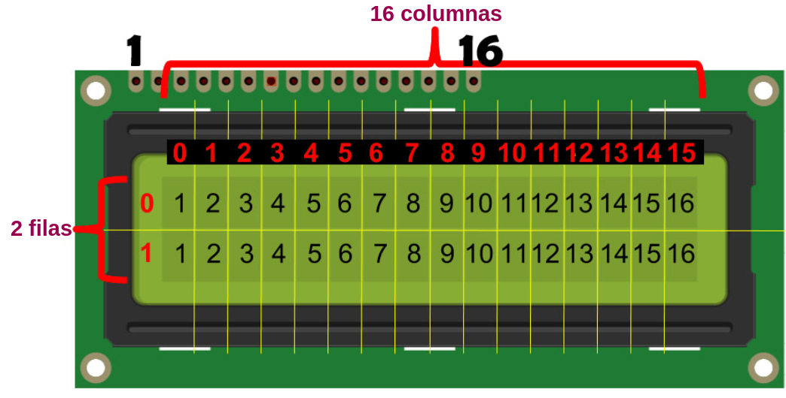
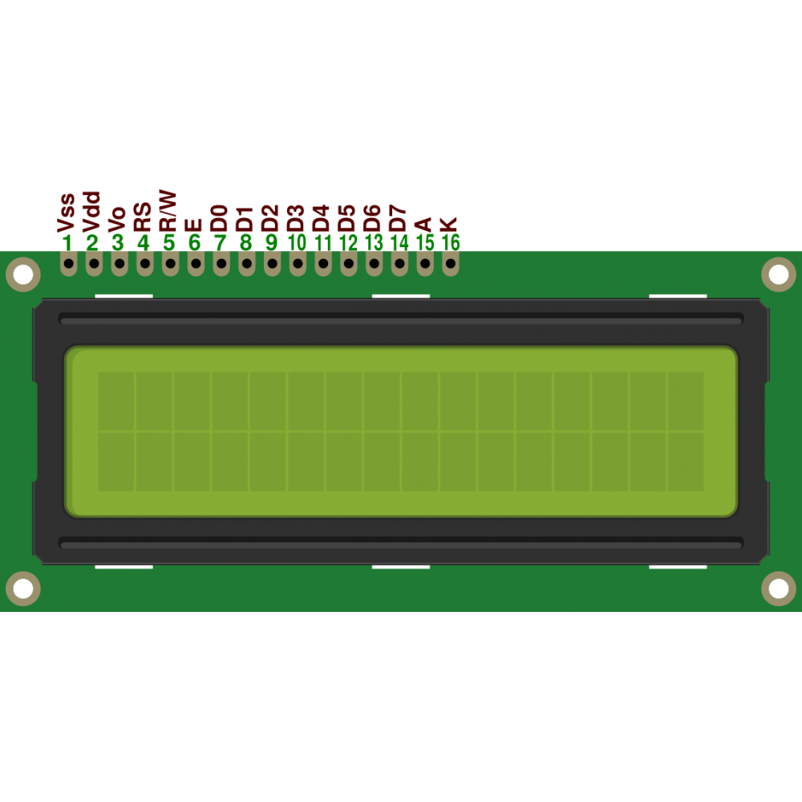
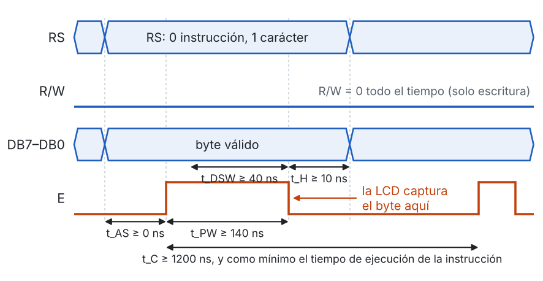
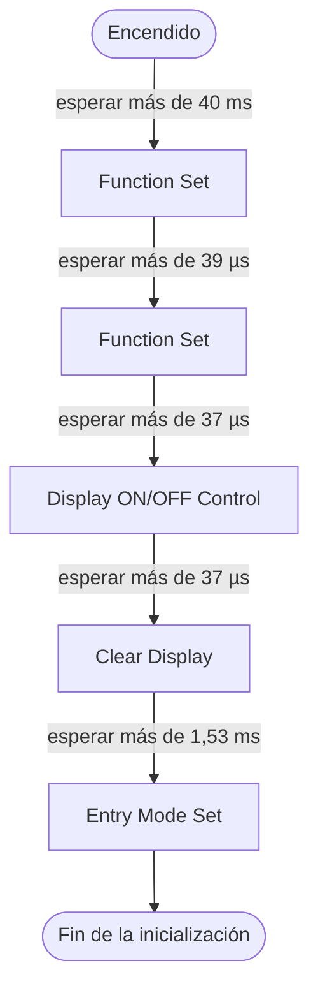
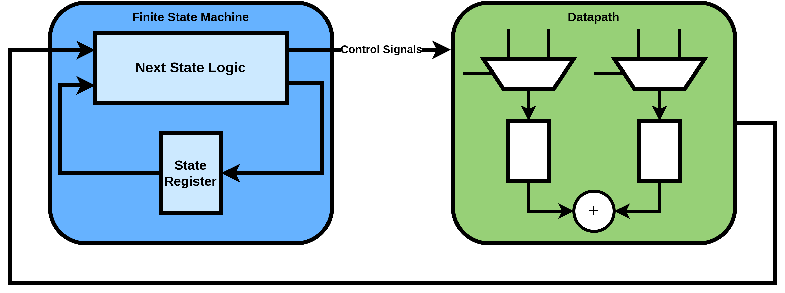
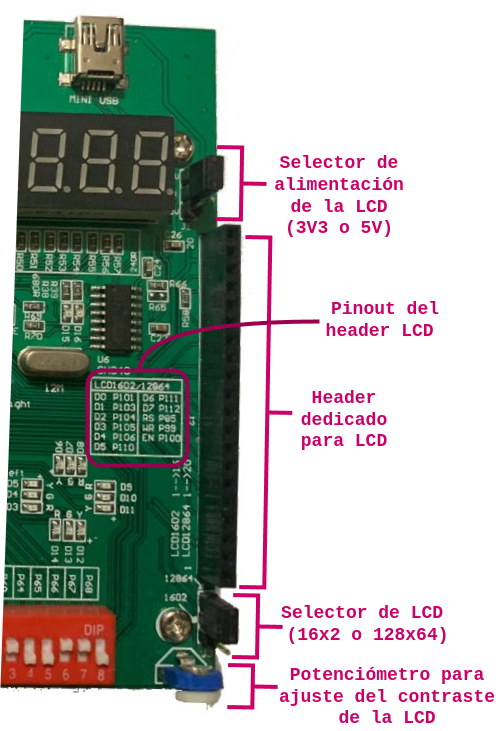
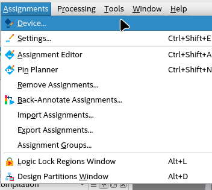
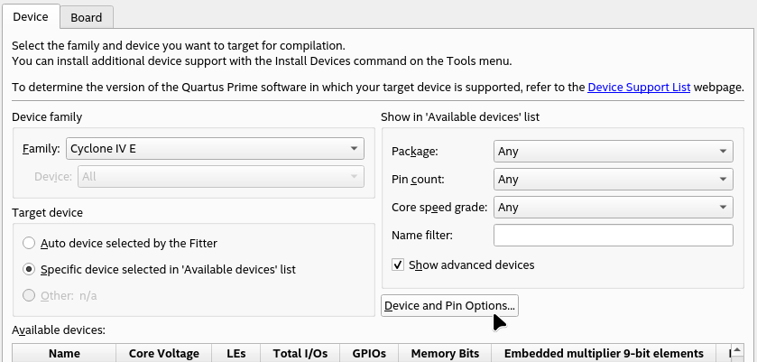
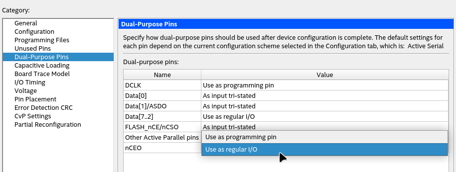

# Laboratorio 5 – Parte 1: Controlador de la LCD 16x2 y texto estático

**Semana 11**

---

## Contenido

1. Objetivos de aprendizaje  
2. Fundamento teórico  
   2.1 La pantalla LCD 16x2  
   2.2 Pines de la pantalla  
   2.3 El controlador interno de la LCD  
   2.4 Conjunto de instrucciones  
   2.5 Ciclo de escritura  
   2.6 Secuencia de inicialización  
   2.7 Mapa de la DDRAM y posición del cursor  
   2.8 Códigos de los caracteres  
   2.9 Arquitectura de un controlador: unidad de control y ruta de datos  
   2.10 Interfaz eléctrica entre la FPGA y la LCD  
3. Especificación  
   3.1 Código base  
   3.2 Recorrido guiado por el código base  
   3.3 Actividades  
   3.4 Requisitos  
4. Pre-informe  
5. Implementación y criterios de validación  

---

## 1. Objetivos de aprendizaje

- Interpretar la hoja de datos de un periférico: instrucciones, tiempos y secuencia de inicialización.
- Analizar una descripción en Verilog organizada como unidad de control (máquina de estados) y ruta de datos.
- Representar una máquina de estados existente mediante su diagrama de estados y su tabla de transiciones.
- Verificar el diseño en simulación con un modelo de la pantalla que revisa los tiempos de la hoja de datos.
- Implementar el controlador en la tarjeta Cyclone IV y mostrar texto en las dos filas de la pantalla.

---

## 2. Fundamento teórico

Esta sección resume lo necesario para la Parte 1. El documento de [fundamentos básicos](Fundamentos.md) explica, con códigos sencillos, las técnicas que usa el código base: contadores para medir tiempo, máquinas de estados, *handshake* entre dos máquinas y textos en Verilog.

### 2.1 La pantalla LCD 16x2

En sistemas embebidos y arquitecturas digitales, la interacción con dispositivos de visualización es esencial para presentar información en tiempo real. Entre estos dispositivos, las pantallas LCD alfanuméricas de 16x2 son muy utilizadas por su simplicidad y bajo consumo.

LCD significa "pantalla de cristal líquido" (*Liquid Crystal Display*). El nombre 16x2 se debe a que tiene 16 columnas y 2 filas, es decir, 32 caracteres en total. Cada carácter se dibuja en una matriz de 5×8 puntos.

<p align="center">
 
</p>
<p align="center">
 Figura 1: Organización de la pantalla LCD 16x2
</p>

Características principales:

* Alimentación de la lógica: 4,5 V a 5,5 V (típico 5,0 V), con un consumo de unos 1,2 mA sin retroiluminación.
* Pantalla alfanumérica: letras, números y algunos símbolos.
* Dos filas de 16 caracteres; cada carácter es una matriz de 5×8 puntos.
* Bus de datos de 8 bits o de 4 bits. **En la tarjeta del curso se usa el modo de 8 bits**, porque el *header* de la LCD conecta las 8 líneas de datos a la FPGA.
* Permite definir hasta 8 caracteres personalizados.

Controlar la pantalla exige enviarle una secuencia precisa de instrucciones, en el orden correcto y respetando sus tiempos, para inicializarla, ubicar el cursor y escribir los caracteres. Una máquina de estados finitos (FSM) en hardware permite organizar esa secuencia de forma clara.

### 2.2 Pines de la pantalla

<p align="center">
 
</p>
<p align="center">
 Figura 2: Pines de la pantalla LCD 16x2
</p>

| Pin | Nombre | Función |
|---|---|---|
| 1 | Vss | Tierra (GND) |
| 2 | Vdd | Alimentación de la lógica |
| 3 | Vo | Ajuste de contraste (potenciómetro de la tarjeta) |
| 4 | RS | Selección de registro: 0 = instrucción, 1 = dato (carácter) |
| 5 | R/W | 0 = escritura en la LCD, 1 = lectura desde la LCD |
| 6 | E | Habilitación: la LCD captura el byte en el **flanco de bajada** de E |
| 7–14 | D0–D7 | Bus de datos de 8 bits |
| 15 | A | Ánodo de la retroiluminación (+) |
| 16 | K | Cátodo de la retroiluminación (–) |

**Se recomienda revisar en detalle la [hoja de datos](lcd016n002bcfhet.pdf) de la LCD 16x2.** La pantalla del laboratorio usa un controlador compatible con el HD44780 (ST7066U), el más común en este tipo de módulos.

### 2.3 El controlador interno de la LCD

La pantalla tiene un pequeño controlador que recibe bytes por el bus y los interpreta. Sus elementos principales son:

- **Registro de instrucción (IR):** recibe los bytes con `RS = 0`. Cada byte es una orden: borrar, encender la pantalla, mover el cursor, etc.
- **Registro de datos (DR):** recibe los bytes con `RS = 1`. Cada byte es el código de un carácter que se va a mostrar.
- **DDRAM (*Display Data RAM*):** memoria donde se guardan los códigos de los caracteres que se ven en la pantalla. Cada posición de la pantalla corresponde a una dirección de la DDRAM (sección 2.7).
- **CGROM (*Character Generator ROM*):** memoria con el dibujo de 5×8 puntos de cada carácter. El controlador la usa para convertir cada código guardado en la DDRAM en puntos visibles.
- **Contador de direcciones (AC):** indica en qué dirección de la DDRAM se escribirá el siguiente carácter. Después de cada escritura se incrementa solo, por lo que los caracteres de una fila se envían uno tras otro sin indicar su dirección.
- **Bandera de ocupado (*busy flag*):** indica que el controlador todavía está ejecutando la instrucción anterior. Se puede leer con `R/W = 1`, pero en este laboratorio la LCD **solo se escribe**: en lugar de leer la bandera, el controlador de la FPGA espera un tiempo fijo, mayor que el tiempo de ejecución de cada instrucción.

### 2.4 Conjunto de instrucciones

Cada instrucción es un byte que se envía con `RS = 0` y `R/W = 0`. Los bits marcados con letras configuran la instrucción; los marcados con – no importan.

| Instrucción | DB7 | DB6 | DB5 | DB4 | DB3 | DB2 | DB1 | DB0 | Efecto | Tiempo de ejecución |
|---|---|---|---|---|---|---|---|---|---|---|
| Clear Display | 0 | 0 | 0 | 0 | 0 | 0 | 0 | 1 | Llena la DDRAM con espacios y lleva el AC a 0x00 | 1,53 ms |
| Return Home | 0 | 0 | 0 | 0 | 0 | 0 | 1 | – | Lleva el AC a 0x00 sin borrar | 1,53 ms |
| Entry Mode Set | 0 | 0 | 0 | 0 | 0 | 1 | I/D | S | I/D = 1: el AC se incrementa; S = 1: desplaza la pantalla | 39 µs |
| Display ON/OFF | 0 | 0 | 0 | 0 | 1 | D | C | B | D: pantalla encendida; C: cursor visible; B: cursor parpadeante | 39 µs |
| Cursor/Display Shift | 0 | 0 | 0 | 1 | S/C | R/L | – | – | Mueve el cursor o desplaza la pantalla | 39 µs |
| Function Set | 0 | 0 | 1 | DL | N | F | – | – | DL = 1: bus de 8 bits; N = 1: dos líneas; F = 1: caracteres de 5×11 | 39 µs |
| Set CGRAM Address | 0 | 1 | A5 | A4 | A3 | A2 | A1 | A0 | Selecciona una dirección de caracteres personalizados | 39 µs |
| Set DDRAM Address | 1 | A6 | A5 | A4 | A3 | A2 | A1 | A0 | Lleva el AC a la dirección A6–A0 (mueve el cursor) | 39 µs |

Para escribir un carácter se envía su código con `RS = 1`. El controlador lo guarda en la dirección que indica el AC y luego incrementa el AC. El tiempo de ejecución es de 43 µs.

### 2.5 Ciclo de escritura

Para enviar un byte, la FPGA debe poner RS y el dato en el bus, generar un pulso en E y esperar a que la LCD termine de ejecutar la instrucción antes de enviar la siguiente.

<p align="center">
 
</p>
<p align="center">
 Figura 3: Ciclo de escritura (hoja de datos, sección 12.1)
</p>

| Parámetro | Símbolo | Mínimo |
|---|---|---|
| Ciclo de E | t<sub>C</sub> | 1200 ns |
| Ancho del pulso E | t<sub>PW</sub> | 140 ns |
| Preparación de RS y R/W antes de subir E | t<sub>AS</sub> | 0 ns |
| Dato estable antes de bajar E | t<sub>DSW</sub> | 40 ns |
| Dato estable después de bajar E | t<sub>H</sub> | 10 ns |

Estos tiempos son muy cortos comparados con el tiempo de ejecución: un carácter tarda 43 µs en guardarse, unas 35 veces más que el ciclo mínimo de E. Por eso el tiempo total de escritura lo marca la espera de ejecución, no el pulso de E.

En una FPGA, todos estos tiempos se generan contando ciclos de reloj, como en el Lab 4: con un reloj de 50 MHz, cada ciclo dura 20 ns y un intervalo *t* equivale a *N = t · f<sub>clk</sub>* ciclos.

### 2.6 Secuencia de inicialización

Después de encender la alimentación, el controlador de la LCD necesita un tiempo para arrancar y luego una serie de instrucciones que fijan su modo de trabajo. La hoja de datos (sección 13, interfaz de 8 bits) indica esta secuencia:



Antes de terminar esta secuencia la pantalla no muestra caracteres. Si el contraste está bien ajustado, una LCD sin inicializar muestra la primera fila como 16 bloques oscuros; esta es una prueba útil para saber si el problema es de conexión o de configuración.

### 2.7 Mapa de la DDRAM y posición del cursor

En el modo de dos líneas, cada posición visible de la pantalla tiene una dirección fija en la DDRAM. Las dos filas **no** son consecutivas: la segunda empieza en la dirección 0x40.

| Columna | 0 | 1 | 2 | 3 | 4 | 5 | 6 | 7 | 8 | 9 | 10 | 11 | 12 | 13 | 14 | 15 |
|---|---|---|---|---|---|---|---|---|---|---|---|---|---|---|---|---|
| **Fila 1** | 00 | 01 | 02 | 03 | 04 | 05 | 06 | 07 | 08 | 09 | 0A | 0B | 0C | 0D | 0E | 0F |
| **Fila 2** | 40 | 41 | 42 | 43 | 44 | 45 | 46 | 47 | 48 | 49 | 4A | 4B | 4C | 4D | 4E | 4F |

Direcciones en hexadecimal.

Para ubicar el cursor en una posición se envía la instrucción **Set DDRAM Address**: un 1 en el bit 7 seguido de los 7 bits de la dirección. Los caracteres siguientes se escriben a partir de esa posición, porque el AC se incrementa después de cada escritura.

### 2.8 Códigos de los caracteres

El byte que se envía con `RS = 1` es el **código** del carácter. En el controlador de la LCD, los códigos de las letras, los dígitos y los signos comunes coinciden con el código ASCII:

| Carácter | Código | Carácter | Código | Carácter | Código |
|---|---|---|---|---|---|
| espacio | 0x20 | `0` | 0x30 | `A` | 0x41 |
| `!` | 0x21 | `1` | 0x31 | `B` | 0x42 |
| `-` | 0x2D | `9` | 0x39 | `Z` | 0x5A |
| `.` | 0x2E | `:` | 0x3A | `a` | 0x61 |
| `/` | 0x2F | `=` | 0x3D | `z` | 0x7A |

Para otros símbolos se debe consultar la tabla de caracteres de la hoja de datos (sección 10): algunos códigos no coinciden con ASCII, y los de las letras acentuadas dependen del modelo de pantalla. Por eso el texto del laboratorio se escribe sin tildes ni ñ.

En Verilog, una cadena entre comillas se guarda como la secuencia de los códigos ASCII de sus caracteres, 8 bits por carácter y con el **primer carácter en los bits más significativos**:

```verilog
parameter [8*16-1:0] LINEA1 = "Electronica Dig.";   // 16 caracteres = 128 bits
// LINEA1[127:120] = "E" = 8'h45,  LINEA1[7:0] = "." = 8'h2E
```

### 2.9 Arquitectura de un controlador: unidad de control y ruta de datos

Un sistema digital que ejecuta una secuencia de pasos suele dividirse en dos partes:

- **Unidad de control:** una máquina de estados que decide qué paso se ejecuta y cuándo se pasa al siguiente.
- **Ruta de datos (*datapath*):** los registros, contadores, memorias y multiplexores que guardan y transforman los datos. La unidad de control la gobierna con **señales de control** y recibe de ella **señales de estado** (por ejemplo, "el contador llegó a su valor final").

<p align="center">
 
</p>
<p align="center">
 Figura 4: Unidad de control (FSM) y ruta de datos
</p>

Cuando una tarea se repite muchas veces, como escribir un byte en la LCD, conviene encapsularla en un **módulo propio con su propia máquina de estados**. La máquina principal no necesita saber cómo se genera el pulso de E: solo le pide al módulo que escriba un byte y espera a que termine. Esa conversación se hace con dos señales, un esquema conocido como ***handshake***:

- **`iniciar`:** la máquina principal pide una escritura (pulso de un ciclo), con el byte y RS ya listos.
- **`listo`:** el módulo de escritura avisa que terminó (pulso de un ciclo), incluida la espera de ejecución.

Así, cada máquina tiene pocos estados y una función clara, y el módulo de escritura se puede reutilizar sin cambios.

### 2.10 Interfaz eléctrica entre la FPGA y la LCD

Las salidas de la FPGA trabajan a 3,3 V, mientras que la lógica de la LCD se especifica para 5 V. Esto tiene dos consecuencias:

- **La LCD nunca debe manejar el bus.** Si R/W valiera 1, la pantalla pondría niveles de hasta 5 V en las líneas de datos, que son pines de la FPGA. Por eso el controlador fija `lcd_rw = 0` y nunca lee la pantalla.
- **Los niveles de entrada de la LCD deben revisarse.** La hoja de datos define el nivel alto mínimo de entrada (V<sub>IH</sub>) en función de V<sub>DD</sub>. Para que la LCD reconozca un 1, el nivel alto de salida de la FPGA debe ser mayor que V<sub>IH</sub>; por eso es importante la posición del selector de alimentación de la LCD (sección 5).

---

## 3. Especificación

### 3.1 Código base

El código base está en las carpetas [`src`](src) y [`test`](test) de esta guía. Implementa un controlador completo que inicializa la LCD y escribe un texto fijo de 16 caracteres en cada fila.

| Archivo | Contenido |
|---|---|
| `src/lcd_escritura.v` | Ciclo de escritura de un byte: RS y dato, pulso de E y espera de ejecución. Tiene su propia máquina de estados |
| `src/lcd_ctrl.v` | Controlador: máquina de estados principal (inicialización y escritura de las dos filas) y ruta de datos |
| `src/lcd_top.v` | Módulo superior para la tarjeta: invierte el reset y define el texto de cada fila |
| `test/modelo_lcd.v` | Modelo de la pantalla para simulación: guarda los caracteres, revisa los tiempos de la hoja de datos e imprime en consola lo que se vería |
| `test/tb_lcd.v` | Testbench: compara lo que muestra el modelo con el texto esperado y reporta OK o FALLO |

Interfaz de `lcd_ctrl`:

| Puerto o parámetro | Dirección | Descripción |
|---|---|---|
| `CLK_FREQ` | parámetro | Frecuencia del reloj en Hz (50 000 000 en la tarjeta) |
| `LINEA1`, `LINEA2` | parámetro | Texto de cada fila: exactamente 16 caracteres |
| `clk`, `rst` | entrada | Reloj y reset síncrono, activo en alto |
| `lcd_rs`, `lcd_rw`, `lcd_e` | salida | Señales de control de la LCD |
| `lcd_data[7:0]` | salida | Bus de datos D7–D0 |

### 3.2 Recorrido guiado por el código base

Esta sección explica cómo está organizado el código, para que el análisis y los diagramas se hagan leyendo el código con una idea clara de qué buscar. Conviene tener abiertos los archivos mientras se lee.

#### `lcd_top.v`: conexión con la tarjeta

Es el módulo que se sintetiza. Solo hace dos cosas: invierte el reset (el pulsador de la tarjeta es activo en bajo y el controlador usa reset activo en alto) y fija el texto de cada fila con los parámetros `LINEA1` y `LINEA2`.

#### `lcd_escritura.v`: escribir un byte

Este módulo sabe **cómo** se escribe un byte en la LCD, pero no sabe qué byte enviar. Cuando recibe un pulso en `iniciar`, guarda `rs_in` y `dato_in`, genera el pulso de E, espera el tiempo de ejecución y avisa con un pulso en `listo`.

Su máquina de estados tiene cuatro estados:

| Estado | Qué hace | Cuánto dura |
|---|---|---|
| `REPOSO` | Espera una orden en `iniciar` | Hasta que llegue la orden |
| `PREPARAR` | Mantiene RS y el byte en el bus antes de subir E | 1 µs |
| `PULSO_E` | Mantiene E en 1; al salir de este estado E baja y la LCD captura el byte | 1 µs |
| `EJECUTAR` | Espera a que la LCD ejecute la instrucción | 50 µs, o 2 ms si `espera_larga = 1` |

Puntos para leer el código:

- **Los tiempos están en ciclos de reloj.** `CICLOS_US = CLK_FREQ / 1_000_000` es el número de ciclos en 1 µs (50 a 50 MHz), y los demás tiempos se escriben a partir de él.
- **Un solo contador mide la duración de todos los estados.** La línea `if (rst || estado != siguiente) cuenta <= 0;` lo pone en cero cada vez que la máquina cambia de estado; así, en cada estado la cuenta empieza desde 0.
- **Las condiciones de salida** son las señales `fin_prep`, `fin_pulso` y `fin_ejec`, que comparan la cuenta con el último valor de cada tiempo.
- **E sale de un flip-flop** (`lcd_e <= (siguiente == PULSO_E);`). Así no tiene pulsos espurios, que la LCD interpretaría como escrituras.

#### `lcd_ctrl.v`: qué bytes enviar y en qué orden

Este módulo contiene la máquina de estados principal y la ruta de datos. Cada byte lo envía a través de `lcd_escritura`.

Estados de la máquina principal:

| Estado | Qué hace |
|---|---|
| `ESPERA_ENCENDIDO` | Espera 50 ms después del reset, para que la LCD arranque |
| `CONFIG` | Envía, uno por uno, los 5 comandos de inicialización (sección 2.6) |
| `DIR_LINEA1` | Ubica el cursor al comienzo de la fila 1 |
| `LINEA1_TXT` | Envía los 16 caracteres de la fila 1 |
| `DIR_LINEA2` | Ubica el cursor al comienzo de la fila 2 |
| `LINEA2_TXT` | Envía los 16 caracteres de la fila 2 |
| `FIN` | No hace nada más: el texto queda en la pantalla |

Elementos de la ruta de datos:

| Elemento en el código | Tipo de bloque | Para qué sirve |
|---|---|---|
| `espera` | Contador | Mide los 50 ms de la espera de encendido |
| `idx` | Contador (0 a 4) | Indica cuál comando de configuración se envía |
| `cmd_config` | Memoria de comandos (`case`) | Entrega el comando número `idx` |
| `col` | Contador (0 a 15) | Indica cuál carácter de la fila se envía |
| `caracter(LINEA1, col)` | Multiplexor | Extrae el carácter número `col` del texto |
| `dato_sel`, `rs_sel` | Multiplexor | Escogen, según el estado, el byte que se envía y si es instrucción o carácter |
| `espera_larga` | Comparador | Vale 1 cuando el comando es Clear Display |

Comunicación con `lcd_escritura` (*handshake*):

- `listo` llega desde `lcd_escritura` cada vez que termina un byte. Con él avanzan los contadores `idx` y `col`, y la máquina principal decide si cambia de estado.
- `iniciar` se genera en `lcd_ctrl` para pedir el siguiente byte. La señal `avanzar` indica el momento en que termina un paso: el fin de la espera de encendido o un `listo`.

#### `test/`: testbench y modelo de la pantalla

`tb_lcd.v` conecta `lcd_ctrl` al modelo `modelo_lcd.v`, que se comporta como la LCD: captura cada byte en el flanco de bajada de E, guarda los caracteres, revisa los tiempos de la hoja de datos e imprime la pantalla en la consola. Al final, el testbench compara las dos filas con el texto esperado y escribe `OK` o `FALLO`.

### 3.3 Actividades

1. **Analizar** el código con ayuda del recorrido anterior.
2. **Diagramar:**
    - la arquitectura completa, separando la unidad de control, la ruta de datos y el módulo de escritura;
    - la máquina de estados de `lcd_ctrl.v` y la de `lcd_escritura.v`.

    Para obtener un diagrama de estados a partir del código: los estados son las constantes `localparam` del registro de estado; las transiciones y sus condiciones están en el bloque `always @(*)` del siguiente estado; la línea `siguiente = estado;` es la flecha que vuelve al mismo estado cuando no se cumple ninguna condición. Los [fundamentos básicos](Fundamentos.md#3-máquinas-de-estados) (tema 3) muestran el procedimiento con un ejemplo.

3. **Personalizar** el texto: escribir en `LINEA1` y `LINEA2` (archivo `lcd_top.v`) un texto del grupo, por ejemplo el número del grupo y los apellidos, con exactamente 16 caracteres por fila y sin tildes.
4. **Simular** con el testbench y el modelo de la pantalla (sección 4) y revisar las formas de onda.
5. **Implementar** el diseño en la tarjeta Cyclone IV (sección 5).

### 3.4 Requisitos

1. El texto de cada fila debe tener exactamente 16 caracteres; los que sobren se completan con espacios.
2. La simulación debe terminar con `Fallas: 0`: el texto se muestra correctamente y el modelo no reporta errores de tiempo.
3. Los tiempos de `lcd_escritura.v` no se modifican. Si un grupo decide cambiarlos, debe justificarlo con la hoja de datos.

---

## 4. Pre-informe

- **Diseño del sistema:**
  - Diagrama de bloques de la arquitectura completa: unidad de control, ruta de datos (contadores, memoria de comandos, texto, multiplexor) y módulo de escritura, con los nombres de las señales que los conectan.
  - Diagrama de estados de `lcd_ctrl.v` y de `lcd_escritura.v`, con la condición de cada transición.
- **Descripción en HDL:**
  - Explicación breve, con sus palabras, de qué hace cada módulo, indicando en qué parte del código está cada bloque del diagrama de arquitectura.
  - Explicación del *handshake*: qué indica `iniciar`, qué indica `listo` y en qué orden ocurren.
  - Texto elegido por el grupo para cada fila.
- **Simulación:**
  - Salida de consola del testbench, con la pantalla impresa por el modelo.
  - Dos capturas de GTKWave, cada una con una explicación corta:
    - la secuencia completa, con `estado` en formato decimal, señalando dónde empieza cada estado;
    - un ciclo de escritura ampliado, midiendo con los marcadores el ancho del pulso de E.

Comandos de simulación, desde la carpeta que contiene `src` y `test`:

```
iverilog -o sim.vvp test/tb_lcd.v test/modelo_lcd.v src/lcd_ctrl.v src/lcd_escritura.v
vvp sim.vvp
gtkwave tb_lcd.vcd
```

La simulación usa el reloj real de 50 MHz y dura unos 54 ms de tiempo simulado, por lo que tarda algunos segundos. La salida de consola debe verse así, con el texto del grupo:

```
        +----------------+
  LCD   |Electronica Dig.|
  LCD   |  LCD 16x2 OK   |
        +----------------+  display encendido, 39 escrituras, 0 errores
OK    fila 1 = "Electronica Dig."
OK    fila 2 = "  LCD 16x2 OK   "
Tiempo total: 54.08 ms   Fallas: 0
```

Para ver el texto del grupo en la simulación se cambian también los textos `TXT1` y `TXT2` de `tb_lcd.v`.

Señales útiles en GTKWave (panel *SST*, a la izquierda): `lcd_e`, `lcd_rs`, `lcd_data` (en hexadecimal), `dut.estado`, `dut.iniciar`, `dut.listo` y `dut.u_escritura.estado`. Como la simulación dura 54 ms y un pulso de E dura 1 µs, hay que ampliar bastante (*zoom*) para ver un ciclo de escritura.

---

## 5. Implementación y criterios de validación

### 5.1 Implementación (informe)

1. En la tarjeta hay un *header* para pantallas LCD 16x2 o 128x64. Conectar la pantalla de modo que el pin 1 marcado en su PCB coincida con el pin 1 marcado en la PCB de la tarjeta. La figura muestra el *header* y los demás elementos de configuración:

    <p align="center">
    
    </p>
    <p align="center">
    Figura 5: Header de la LCD en la tarjeta Cyclone IV
    </p>

2. Revisar los selectores (*jumpers*): el de alimentación de la LCD (3V3 o 5V) y el de tipo de pantalla (16x2 o 128x64). Documentar en la bitácora qué posición se usó y por qué.

3. Asignar los pines en el **Pin Planner** de Quartus según la tabla impresa en la PCB de la tarjeta:

    | Señal | Pin | Señal | Pin |
    |---|---|---|---|
    | `lcd_data[0]` | PIN_101 | `lcd_data[6]` | PIN_111 |
    | `lcd_data[1]` | PIN_103 | `lcd_data[7]` | PIN_112 |
    | `lcd_data[2]` | PIN_104 | `lcd_rs` | PIN_85 |
    | `lcd_data[3]` | PIN_105 | `lcd_rw` | PIN_99 |
    | `lcd_data[4]` | PIN_106 | `lcd_e` | PIN_100 |
    | `lcd_data[5]` | PIN_110 | `clk` | PIN_23 (50 MHz) |

    El reset (`rst_n`) se asigna a un pulsador de usuario, según el manual de la tarjeta.

4. El pin 101 tiene por defecto una función de programación (nCEO). Se debe configurar como E/S normal:

    1. Ir al menú `Assignments` y seleccionar la opción `Device`.

        <p align="center">
        
        </p>

    2. En la ventana `Device`, dar clic en el botón `Device and Pin Options`.

        <p align="center">
        
        </p>

    3. En la ventana `Device and Pin Options`, escoger en la lista `Category` la opción `Dual-Purpose Pins` y cambiar el valor del pin `nCEO` a `Use as regular I/O`.

        <p align="center">
        
        </p>

5. Compilar, programar la tarjeta y ajustar el contraste con el potenciómetro hasta que el texto se vea nítido.

6. Registrar las observaciones de la prueba (incluido cualquier problema de contraste, conexión o alimentación y cómo se resolvió) y la evidencia en foto o video.

### 5.2 Criterios de validación

- Los diagramas de estados coinciden con el código: cada estado y cada transición del código aparecen en el diagrama, con su condición.
- La simulación termina con `Fallas: 0` y el modelo no reporta errores de tiempo.
- En la tarjeta, la pantalla muestra en las dos filas el texto definido por el grupo.
